# GenVo v1 — Anatomical Capability Matrix & Verification

**Document Version:** 1.0.0  
**Authority:** Lead Systems Developer  
**Audit Scope:** 71 anatomical parts across 13 functional physiological systems.  
**Audit Status:** Fully verified via programmatic audit tool `tools/audit-anatomical-capabilities.mjs`. 0 registry errors, 0 cycle errors, 100% prerequisite and runtime linkage.

---

## Executive Summary

GenVo implements a modular, physical anatomical architecture governed by:
- `src/lineage/part-registry.js`: Immutable declarative registry defining sockets, prerequisites, mass, upkeep, mutation costs, and action capabilities.
- `src/lineage/part-abilities.js`: Functional effect factor calculations (`partEffectFactors`, `partFoodFactor`, `landSpeedFactor`, `paddleFactors`) and action controllers (`PartAbilityController`).
- Specialized authorities: `flight.js`, `gliding.js`, `jumping.js`, `climbing.js`, `burrowing.js`, `diving.js`, `thermoregulation.js`, `coat-moisture.js`, `oviparous.js`, `nursing.js`, `functional-diet.js`.

Every part carries real biological tradeoffs: metabolic costs, locomotion penalties, socket constraints, and developmental prerequisite chains. No part grants free power without upkeep or physiological limits.

---

## 13 Major Anatomical Systems Matrix

| System | Key Parts | Prerequisites | Primary Functions & Capabilities | Tradeoffs & Upkeep | Authority Modules |
| :--- | :--- | :--- | :--- | :--- | :--- |
| **1. Fur & Insulation** | `filament-tuft`, `fur-mantle`, `endothermic-core` | `filament-tuft` &rarr; `fur-mantle` &rarr; `endothermic-core` | `insulate`, `thermoregulate`. Reduces cold thermal energy loss, dampens climate damage, protects young in proximity. | Upkeep (0.08 - 0.32), heat penalty in arid biomes, wet fur reduces insulation. | `coat-moisture.js`, `seasonal-coat.js`, `thermoregulation.js` |
| **2. Feathers** | `feather-mantle`, `proto-wing`, `flight-wing` | `filament-tuft` &rarr; `feather-mantle` &rarr; `proto-wing` &rarr; `flight-wing` | `insulate`, `display`, `flare`, `fly`. Water-resistant insulation, courtship displays, powered flight across water and steep relief. | High mass (0.92) & upkeep (0.43), lift constrained by creature body mass, heavy energy cost per second in air. | `flight.js`, `seasonal-coat.js`, `courtship-performance.js` |
| **3. Aquatic** | `webbed-leg`, `paddle-tail`, `silt-fin`, `salt-gland` | `walking-leg` &rarr; `webbed-leg`; `paddle-tail` &rarr; `silt-fin`; `gill-slits` &rarr; `salt-gland` | `swim`, `swim-propel`, `flare`. Enables river/open water swimming, increases aquatic velocity (+25%) and reduces swim energy use (-15%). Salt gland excretes seawater salinity. | Modest penalty to land running speed (-4% to -9%), higher mass. | `marine-food-web.js`, `lifestyle.js`, `part-abilities.js` |
| **4. Diving** | `gill-slits` | `storage-sac` &rarr; `gill-slits` | Underwater respiration while diving, sub-surface foraging, aquatic winter survival under ice cover. | Upkeep 0.08, requires surface access when injured or exhausted, higher dehydration rate on land. | `diving.js`, `aquatic-foraging.js`, `surface-ice.js` |
| **5. Jumping** | `spring-leg` | `walking-leg` &rarr; `spring-leg` | `jump`, `pounce`, `sprint`. Dynamic jump arcs (Enter/Space), escape from stalking predators, terrain ledge clearance. | Increased upkeep (0.18), exertion expenditure, hard/water landings incur impact injury risk. | `jumping.js`, `exertion.js` |
| **6. Gliding & Flight** | `patagium`, `gliding-membrane`, `flight-wing` | `climber-leg` &rarr; `patagium`; `proto-wing` &rarr; `flight-wing` | `glide`, `fly`. Controlled aerial descent from heights/trees/cliffs, obstacle bypass, horizontal glide vectors. | Cannot climb in air without powered wings; mass and energy drag ashore. | `gliding.js`, `flight.js`, `canopy.js` |
| **7. Climbing** | `climber-leg`, `hook-pad`, `grip-pad` | `grasper` &rarr; `climber-leg`; `grip-pad` &rarr; `hook-pad` | `climb`, `carry`, `brace`. Uphill slope purchase, canopy access into living trees, predator roost refuge. | Slower movement on flat ground (-5%), ancestral grasper requirement, continuous stamina upkeep. | `climbing.js`, `canopy.js` |
| **8. Burrowing** | `digging-forelimb` | `walking-leg` &rarr; `digging-forelimb` | `dig`, `walk`. Excavates roots (`marshroot`, `dunebulb`) on open ground with Key E, thinner cover needed to hide, subsurface shelter creation. | -5% sprint speed, soil disturbance records finite resource extraction with regrowth interval. | `digging-rules.js`, `soil-disturbance.js`, `burrowing.js` |
| **9. Defense** | `armor-plate`, `dome-torso`, `thorn-carapace`, `barb`, `dew-claw`, `heel-spike`, `spine-cluster`, `spine-ridge`, `shell-back`, `armored-hide` | `soft-torso` &rarr; `reinforced-torso` &rarr; `dome-torso`; `armor-plate` &rarr; `thorn-carapace`; `barb` &rarr; `heel-spike` | `armor`, `retaliate`, `brace`. Mitigates incoming strike damage (-15% to -26%), penalizes rear bites (-40% to -45%), causes attacker recoil (`repel` chance). | Reduced sprint speed (-7% to -11%), increased body mass, higher metabolic food upkeep. | `combat-actions.js`, `player-combat.js`, `part-abilities.js` |
| **10. Sensory** | `simple-eye`, `wide-field-eye`, `hunter-eye`, `stalk-eye`, `compound-eye`, `tracker-eye`, `display-eye`, `telescopic-eye`, `raptor-eye`, `panoramic-eye`, `sentinel-eye`, `eyespot`, `glow-eye`, `echo-crest`, `sensory-bristle`, `sensory-quills` | `simple-eye` &rarr; `hunter-eye` &rarr; `telescopic-eye` &rarr; `raptor-eye`; `simple-eye` &rarr; `wide-field-eye` &rarr; `compound-eye` &rarr; `panoramic-eye` &rarr; `sentinel-eye`; `spine-ridge` &rarr; `sensory-quills` | `see`, `see-wide`, `aim`, `spot`, `glance`, `track`. Multi-range focal vision, rear/lateral threat detection, seismic vibration sensing through ground contact, forage cue detection. | High upkeep for advanced eyes (up to 0.18), raptor vision loses peripheral awareness, telescopic vision narrows side view. | `vision.js`, `threat-perception.js`, `vibration.js`, `stratum-senses.js` |
| **11. Large Body** | `small-torso` (founder), `soft-torso`, `reinforced-torso`, `sleek-torso`, `light-torso`, `stout-torso`, `barrel-torso`, `dome-torso`, `long-torso` | `small-torso` &rarr; `soft-torso` &rarr; `stout-torso` &rarr; `barrel-torso`; `soft-torso` &rarr; `sleek-torso` &rarr; `long-torso` | Radial socket expansion: unlocks 6, 8, 10, or 12 limb sockets, 2-4 eye sockets, dorsal & flank organ mounts. Higher mass, greater carrying capacity, water retention. | Higher basal metabolic upkeep (0.8 &rarr; 1.35), increased inertia, greater food & water consumption. | `part-registry.js`, `body-plan.js`, `socket-layout.js` |
| **12. Specialized Diets** | `grazing-mouth`, `tearing-jaw`, `crushing-jaw`, `beak-mouth`, `kernel-beak`, `filter-mouth`, `reed-sieve-mouth`, `nibbler-mouth`, `sucker-mouth`, `gape-mouth`, `tusk-jaw` | `grazing-mouth` &rarr; `tearing-jaw` &rarr; `crushing-jaw` / `sucker-mouth` / `gape-mouth`; `grazing-mouth` &rarr; `beak-mouth` &rarr; `kernel-beak`; `grazing-mouth` &rarr; `filter-mouth` &rarr; `reed-sieve-mouth` | Dietary specialization: seed hull cracking (`kernel-beak`), carrion processing (`sucker-mouth`), water filter-feeding while drinking (`filter-mouth`), predatory flesh tearing (`tearing-jaw`, `crushing-jaw`). | Specialized mouths suffer efficiency penalties on non-preferred food types (e.g., seed beaks get less from soft foliage). | `functional-diet.js`, `seed-viability.js`, `foraging.js` |
| **13. Reproduction** | `brood-pouch`, `egg-chamber`, `live-womb`, `mammary-gland`, `scent-gland`, `display-frill` | `storage-sac` &rarr; `brood-pouch`; `endothermic-core` + `live-womb` &rarr; `mammary-gland`; `signal-crest` &rarr; `display-frill` | Oviparity (`egg-chamber` for drought-resistant egg laying), viviparity (`live-womb`), maternal nursing (`mammary-gland`), pheromone dispersal (`scent-gland`), visual courtship displays (`display-frill`). | Substantial mass (0.8 - 1.1) and organ slot consumption, reproductive metabolic cost, postpartum cooldown. | `reproduction.js`, `oviparous.js`, `nursing.js`, `courtship-performance.js` |

---

## Developmental Prerequisite Pathways

All evolutionary pathways follow legitimate natural transitional ancestors:

```mermaid
graph TD
  subgraph Locomotion & Limbs
    walkingLeg["walking-leg"] --> springLeg["spring-leg (Jump/Pounce)"]
    walkingLeg --> grasper["grasper (Manipulate/Carry)"]
    grasper --> climberLeg["climber-leg (Climb/Purchase)"]
    climberLeg --> patagium["patagium (Gliding Membrane)"]
    walkingLeg --> runnerLeg["runner-leg (Land Speed)"]
    walkingLeg --> sturdyLeg["sturdy-leg (Brace)"]
    walkingLeg --> webbedLeg["webbed-leg (Swim)"]
    walkingLeg --> paddedLeg["padded-leg (Stealth)"]
    paddedLeg --> aridPad["arid-pad (Dryland Travel)"]
    walkingLeg --> diggingForelimb["digging-forelimb (Burrow/Roots)"]
  end

  subgraph Integument & Aerodynamics
    filamentTuft["filament-tuft (Proto-Filament)"] --> furMantle["fur-mantle (Cold Fur)"]
    furMantle --> endothermicCore["endothermic-core (Warm-Blooded)"]
    filamentTuft --> featherMantle["feather-mantle (Waterproof Cover)"]
    featherMantle --> protoWing["proto-wing (Display Wing)"]
    protoWing --> flightWing["flight-wing (Powered Flight)"]
  end

  subgraph Trophic & Feeding
    grazingMouth["grazing-mouth (Starter Plant)"] --> tearingJaw["tearing-jaw (Carnivory)"]
    tearingJaw --> crushingJaw["crushing-jaw (Heavy Armor/Bone)"]
    tearingJaw --> suckerMouth["sucker-mouth (Carrion Sucker)"]
    tearingJaw --> gapeMouth["gape-mouth (Predator Swallow)"]
    tearingJaw --> venomGland["venom-gland (Neurotoxin)"]
    grazingMouth --> beakMouth["beak-mouth (Frugivore/Seed)"]
    beakMouth --> kernelBeak["kernel-beak (Hard Seed Cracker)"]
    grazingMouth --> filterMouth["filter-mouth (Aquatic Sieve)"]
    filterMouth --> reedSieveMouth["reed-sieve-mouth (Benthic Sifter)"]
    grazingMouth --> nibblerMouth["nibbler-mouth (Low Upkeep)"]
  end

  subgraph Senses
    simpleEye["simple-eye (Starter)"] --> hunterEye["hunter-eye (Focal Aim)"]
    hunterEye --> telescopicEye["telescopic-eye (Long Range)"]
    telescopicEye --> raptorEye["raptor-eye (Maximum Reach)"]
    simpleEye --> wideFieldEye["wide-field-eye (Wide Peripheral)"]
    wideFieldEye --> compoundEye["compound-eye (Motion Sensitivity)"]
    compoundEye --> panoramicEye["panoramic-eye (360 Vigilance)"]
    panoramicEye --> sentinelEye["sentinel-eye (Periscope Elevation)"]
  end
```

---

## Lab Representation & Save Compatibility

1. **Procedural & Render Representation:** Every part defines full 2D isometric/directional placement offsets (`at: {f, s, u}`) relative to its parent torso, and falls back cleanly to procedural rendering if SVG/vector assets are loading.
2. **Persistence Schema:** Plans serialize to `genvo8.bodyplan/0` with compact node trees `{id, partId, socket, parent, at}`.
3. **No Phantom Powers:** Part abilities are exclusively calculated via `partEffectFactors()`; removing or mutating away a part immediately removes its benefits and upkeeps without residual modifiers.
