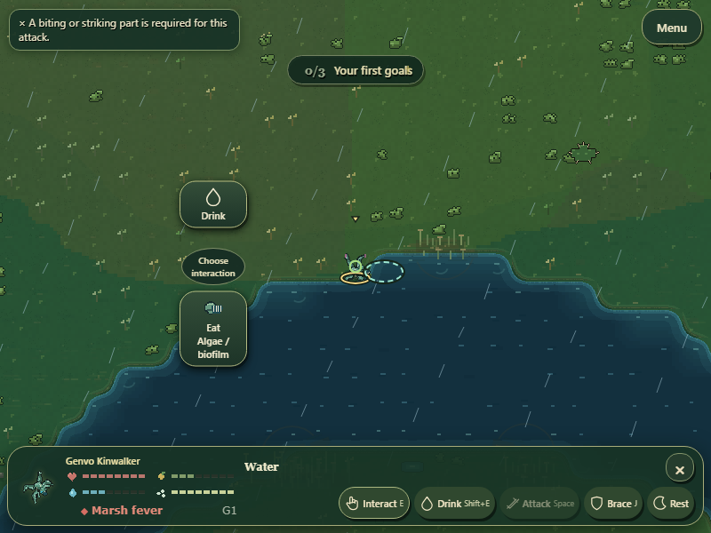
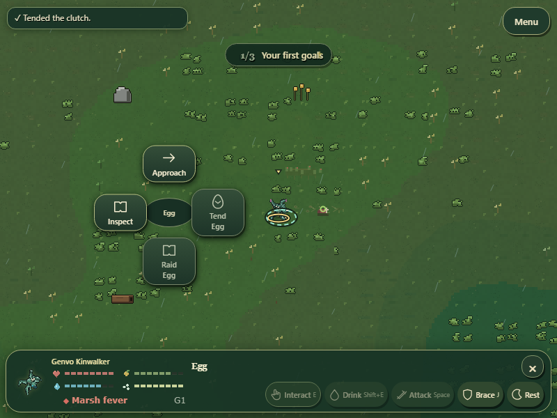
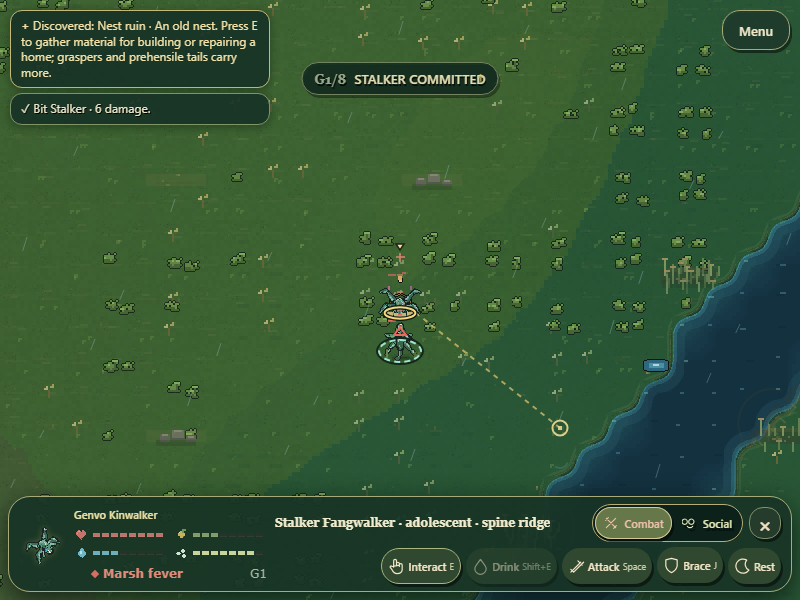
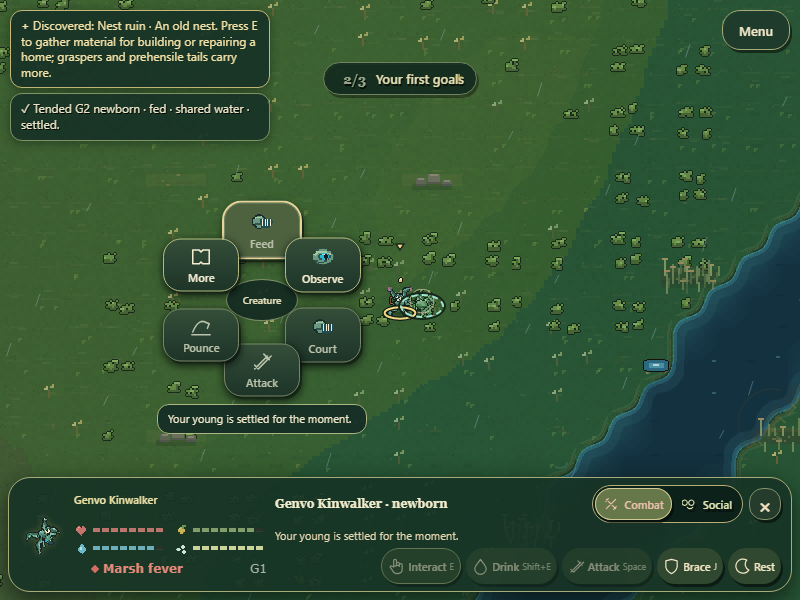
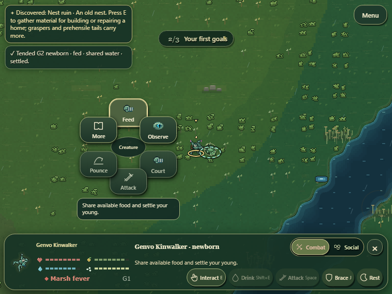

# Contextual quick commands correction

The exploration dock now presents Interact (E), Drink (Shift+E), Attack (Space), held Brace (J), and Rest. Q retains food-selection cycling. Eating is a target-specific action, never a fixed plant-food command. Existing keyboard panels and saves remain operational.

Interact resolves explicit selection first, then the current hovered object, then nearby valid objects in deterministic distance/key order. An invalid explicit target fails with its requirement; it never substitutes unrelated food. Multiple possible interactions open a short radial choice without changing gameplay state. Radial entries have stable action/target keys, including equally named objects, and paginate longer lists. The dock does not duplicate their full action list.

The command adapter composes authoritative availability and execution methods for foraging, drinking, combat, egg care, family care, discovery collection, shelter maintenance, and digging. Approach uses the existing movement controller, followed by target revalidation. Selected water harvest stays bound to its source. Stale meal descriptors cannot grant a different mouth feeding abilities. Basic attacks require mounted physical attack anatomy, including Shift+Space fallback. Herbivorous defensive kills no longer automatically feed meat; root digging respects the existing mouth diet. Existing courtship and defence controllers own their actions.

Rapid routine outcomes replace older routine messages immediately. Critical warnings and objective updates retain separate queues. Native screenshots show readable quick commands and no clipping at 800x600; selected-target status occupies a 96px bottom strip in the recorded fixture.

## Verification

`tools/capture-contextual-commands.cjs` passed real Chromium game workflows at 800x600: grazing-mouth plant consumption and rejected carrion; tearing-jaw carrion consumption and rejected plants; sucker-mouth consumption of both, hovered-target priority and ambiguity; reed-sieve water/algae choice, exact hydration and rejected physical attacks; egg/nest care; finite nest-ruin collection; shelter reinforcement; creature inspection; attack while Social is selected; held pointer defence and release. Save roundtrip retained valid anatomy, eggs and nests. Receipt: [contextual-commands-proof.json](contextual-commands-proof.json). No browser errors or command bounds overflow were recorded.

Fixtures use valid mouth graphs on an existing actor, natural finite food stocks, a corpse produced by the existing death system, a staged funded pregnancy laid through the existing reproduction system, and staged territory readiness followed by canonical shelter construction. These verify execution, not natural mating acceptance or player retention.

Focused tests passed for contextual interactions, read-only availability, stale descriptors, exact water filtering, tutorial dietary guidance, part abilities, selected combat targets, mouse resources, and egg ecology. Existing courtship, held defence, navigation, freshwater and reproduction checks were also run during the pass. First-time human comprehension remains unproven; the broader biological and creature-art roadmap remains active.

## Care command follow-up

The creature radial now includes the same authoritative dependent-care actions offered by Interact. Feed appears only when the existing controller can transfer funded food; otherwise Tend describes available water sharing or reassurance. Availability and execution use one read-only provision calculation, retaining reserves, transfer caps, care effort cost and cooldown. Selected-target changes already cancel pending approach through the existing input controller.

The extended real-browser receipt verifies keyboard Tend without surplus, then radial Feed with surplus. Native 800x600 screenshots were inspected. Focused care-command, family-care, conservation, contextual-interaction and mouse-courtship tests passed, along with the canonical source audit. The old family-care fixture now explicitly tests no eager effect when multiple nearby actions require a choice, then executes care against its intended child; transfer, stress and RNG assertions remain intact.

## Live radial state follow-up

Radial refresh now retains keyboard focus by stable action/target identity and keeps the currently requested explanation visible. Its reason is refreshed from the same authoritative descriptor used by the dock; stale cooldown text is not left behind. Accessible command names remain stable, with restrictions exposed separately as descriptions. Focus retention applies to the currently displayed page; dismissal and changing targets still clear the old explanation.

The native browser workflow focused the disabled care command, changed the real controller cooldown to make it available, and asserted that focus remained on `care|creature:197:` while radial and dock text both matched the current family-controller reason. The 800x600 screenshot was inspected. The full contextual-command and unified-dock browser workflows passed, along with focused care, observable feedback, courtship, combat and held-defence checks. See `liveCareRefresh` in contextual-commands-proof.json.

