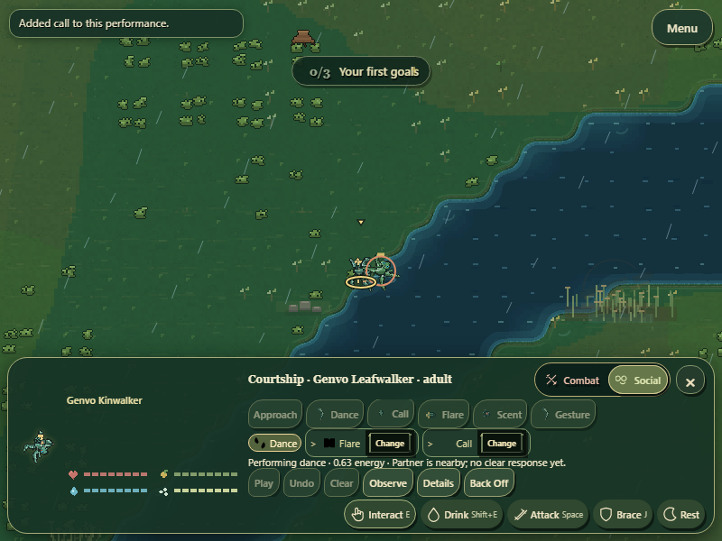
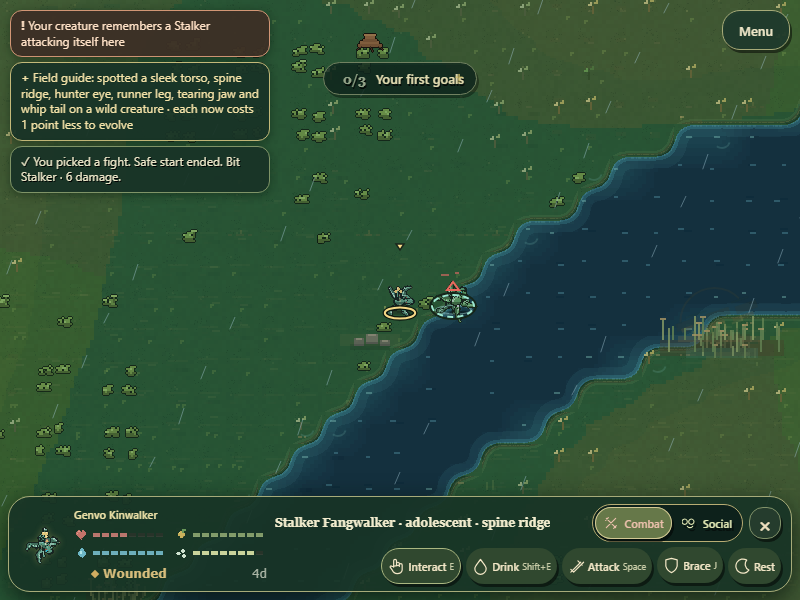

# GenVo — Embodied Encounters

Implementation milestone complete as a development checkpoint. Creator visual approval, unfamiliar-player comprehension, ten-minute engagement and full ecological acceptance remain open. The technical contextual-interaction foundation is also closed; it should not be repeatedly rebuilt as a new feature. Existing human playtest requirements remain separate acceptance work.

## Substantial gameplay change

Courtship is now an ongoing player encounter rather than only a preselected queue followed by waiting. During a funded performance, mouse action cards or the existing 1–5 display keys can add a future beat, up to the existing three-move limit. Change buttons let the player replace a beat that has not started. Current and completed beats cannot be rewritten. Added slots pay the existing incremental energy cost and extend the existing beat duration; replacing prepaid slots charges nothing extra. Practice quality uses the actual resulting sequence, so improvising a new pattern does not inherit an unrelated learned-pattern bonus. The completed sequence still feeds the existing preference, reciprocal-choice and cultural-learning systems. Back Off interrupts without refunding spent effort. No mate tastes, consent rolls, biological compatibility or new free abilities were introduced.

Mate movement now plants a performer once it reaches the existing valid performance radius instead of continuing into the partner's body. Existing activity budgets, survival decisions, target movement and performance interruption remain authoritative. Partners remain free to leave or decline.

Five lawful performances have different whole-body choreography: dance alternates support/swing feet with lateral weight shifts; call raises the head and pulses the mounted mouth; flare raises posture and expands mounted dorsal display art; scent sweeps the mounted tail and produces the existing scent cue; gesture lifts front appendages and sweeps feelers. Timing varies with the performance's existing inherited tempo. Choreography and transient reactions use renderer-owned time and stop advancing when paused. Bodies without an enabling part receive no matching display pose.

Idle nearby recipients visually orient to the actual local display without an acceptance prediction. Actual mating/refusal receipts produce short body responses after the outcome. Combat has stronger coiling, follow-through, planted guard and a decaying whole-body impact response. Existing injury state drives recoil and asymmetric movement; no health or injury is authored by the renderer. Native mouth, crest and tail transforms move actual mounted artwork, not a species template. The persistent dock is unchanged; encounter controls were made to fit after runtime captures exposed clipping.

## Changed gameplay source

| Module | Responsibility |
| --- | --- |
| src/reproduction/courtship-performance.js | Authoritative live future-beat availability/execution, finite funding, duration and correct learned practice quality |
| src/reproduction/reproduction.js | Controller entry points and actual mating-event timestamp |
| src/sim/simulation.js | Plant within the existing courtship radius while respecting movement budgets; stamp actual decline outcomes |
| src/ui/courtship-tray.js, src/main.js | Mouse future-beat editing and existing display-key delegation |
| src/render/encounter-expression.js | New read-only per-creature choreography, neutral local attention and transient outcome/impact responses |
| src/render/renderer.js | Integrate those poses in real creatures, effect timing and cache safety |
| src/render/genvo.js | Actual support/swing and gesture geometry in the shared anatomy pose |
| src/render/genvo-draw.js, src/render/part-sprites.js | Pass body expression to mounted native parts; mouth pulse, crest expansion and tail movement |
| src/render/combat-feedback.js | Stronger canonical attack, brace and recovery physical poses |
| styles.css | Keep complete live controls readable at embedded sizes; no fundamental HUD restructure |

## Runtime verification

Controlled native-browser capture at 800x600: a validated body graph with real display/gesture/scent parts on an existing actor; readiness and local positions staged; no taste or acceptance edits. It exercised live append, prepaid future replacement, all five displays, Back Off, a genuine declined attempt, selected attack, held guard, actual injury from the existing predation/damage controller, and movement after injury. The injury check used bounded canonical contact attempts against a diet-compatible hunter; it did not write health, damage, chance, RNG or injury fields. The recorded hit dealt 46.34 damage and left the player alive at 53.74 health with the real Wounded condition. This is controlled combat evidence, not a naturally encountered injury claim.

Runtime screenshots and continuous video were inspected through native frames and a temporal motion sheet. The recorded expanded encounter measured 190–196px high at 800x600 depending on the future-beat controls; ordinary exploration returned to 65px and selected creature status to 96px. No page errors or horizontal control clipping were recorded. The previous complete-dock and four-diet contextual browser workflows passed, including survival, care, exact targeting and saves. Receipts: embodied-encounters-proof.json, hierarchy-proof.json and contextual-commands-proof.json.

Separate normal-speed natural observation: a fresh generated world ran for 120 seconds with only the ordinary Auto UI toggle. No actor/anatomy/resource/readiness/RNG/time edits or outcomes were forced. Visible native telemetry recorded 3 distinct dance actors, 4 call actors, 6 declined participant records and 2 paired participant records. Participant counts are not numbers of independent mating events. The player survived through day 21 with no mate or offspring; visible wild displays and a real mating outcome occurred. No natural flare/scent/gesture or injury was observed in this bounded run. It does not prove retention, long-run balance or all evolved anatomy combinations. Receipt: natural-encounters-proof.json.

Focused tests passed: live anatomy validity, future/current beat boundaries, costs, practice quality, pause, saved active sequences, Back Off, planted movement, read-only reaction/RNG invariance; original courtship and reproduction; selected combat and held guard; native face/contact/pigment/head/joint/depth; dietary/contextual/water/manual-resource poses; public export and canonical source audit. No failing assertion was skipped and no viewport budget was raised. Earlier fixture failures and clipping were corrected rather than presented as product acceptance.

## Next meaningful milestone

Anatomy-driven world discovery and ecological activities: let the player find and investigate genuine tracks, calls, feeding traces and witnessed behavior through existing discovery, cognition and interaction authorities, with useful survival/lineage consequences between generations. First audit those existing modules to select the complete unfinished slice. Fixed biological species authority and broader evolutionary compatibility remain unfinished, not silently solved by this presentation pass.

[Continuous runtime encounter video](embodied-encounters-runtime.webm)
