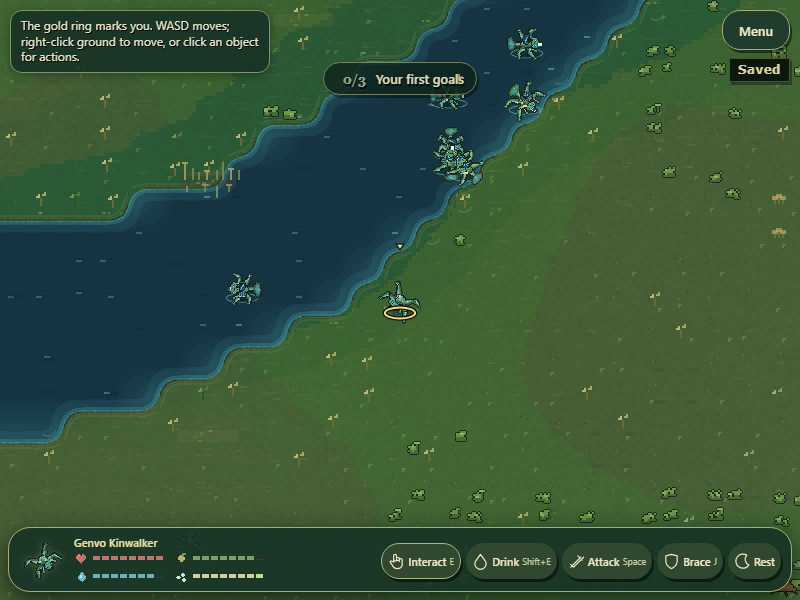
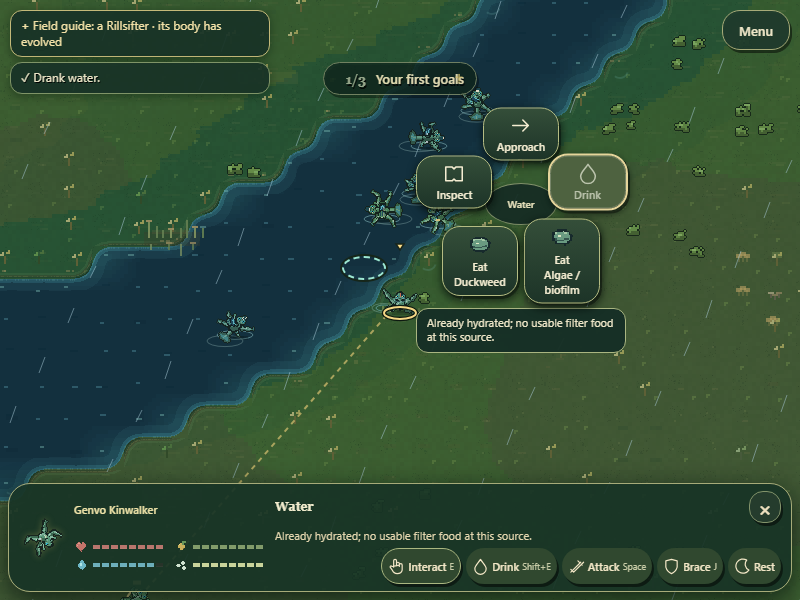

# GenVo First-Time Player Experience & Interaction Polish

Status: interaction foundation integrated; opening walkthrough verified; first-time human comprehension and 10-minute experience acceptance open. Fundamental interaction layout is frozen for this milestone. Changes should address observed failures in discovery, response, animation or explanation, preserving existing biology and controllers.

## Current source and evidence review

The live entrypoint connects CreatureContextTray to canonical interaction composition, resource/foraging/freshwater methods, selected-target combat, reproductive care, family care, collection and shelter controllers. Radial entries and quick commands re-query the same current gameplay descriptors. Pending approaches are cancelled by target selection changes. Stable action/target identities preserve focus and refresh restriction reasons. No fixed food-specific persistent action remains. Save roundtrip checks cover current valid anatomy, eggs and nests; they are not evidence that every historical save format remains supported.

Controlled browser evidence remains in contextual-commands-proof.json and hierarchy-proof.json. Four dietary anatomies and exact-target behavior are covered, alongside selected combat, care, finite resources and controller-owned effects. These fixtures explicitly stage some reproductive, territory and physiological states. They do not establish naturally occurring mating success or ecological stability.

New evidence: tools/capture-first-play.cjs creates a fresh world, leaves generated anatomy, actors, reserves, stocks and readiness unchanged, and uses actual keys and mouse actions at 800x600. Read-only instrumentation selects visible targets for a reviewer-driven route. Movement, native food consumption, approach-and-drink and creature inspection completed; first-play-proof.json records positive meal gain, actual drink, changing position and no browser errors. Native screenshots were inspected. This is a short guided walkthrough, not two, five or ten minutes of unassisted play and not a retention result.

The first walkthrough incorrectly clicked a creature standing over the sampled water. The capture now excludes creature hit areas when selecting its water point; the game correctly prioritized the creature. No gameplay water rule was changed for this harness mistake.

## Focused discoverability changes

New-world entry now briefly identifies the gold player ring and explains movement plus world clicks without forcing a tutorial panel. Opening suggestions describe mouse water/food/courtship actions before keyboard alternatives. Interact hover and accessible descriptions explain explicit targeting, E, and Q cycling of compatible nearby food. Help and opening briefing use current Interact and independent Drink terminology. Q remains an optional keyboard shortcut; direct mouse food selection remains available. No dock restructuring or biological redesign was introduced.

Opening-goal, dietary-guide, observable-feedback and source-authority checks passed. The existing complete compact-dock browser workflow passed after the text/description changes. Native opening and water-result screenshots were inspected.

## Human playtest protocol

Use 800x600, a fresh save and normal speed. Recruit people who have not played GenVo; vary seeds across sessions. Give only this prompt: “You are a creature in this world. Explore and try to stay alive.” Let the opening cues run normally. Avoid coaching, pointing at controls or explaining genetics. Record the screen and notes with participant permission. Mark every facilitator intervention; do not count coached actions as independent discovery.

| Checkpoint | Observe | Record |
| --- | --- | --- |
| First 30 seconds | Identifies their creature, discovers movement, clicks an interesting object | First successful movement/selection time, wrong-target clicks, questions |
| First 2 minutes | Finds compatible food, water and inspection through mouse actions | Successful action/outcome recognition, use of Interact/E, whether Q is discovered or unnecessary |
| First 5 minutes | Reads another creature's reaction, considers Court, recognizes danger and responds | Misread reactions, failures with unexplained reasons, loss of selected target, recovery attempts |
| First 10–15 minutes | Finds an anatomy, behavior, reproduction or ecology detail worth pursuing | Participant's own curiosity statement and next intention; no inferred engagement score |

At the end ask: “Which creature was yours?”, “What did Interact do?”, “How would you choose a different food?”, “What happened when an action failed?”, and “What would you try next?” Ask about E and Q after play, not as a task prompt. Observe whether mouse choices make Q unnecessary; shortcut recall is not a required survival goal.

Keep exact events separate from interpretation. An example record is: timestamp, selected target, input, visible availability/reason, controller result, visible response, participant words, facilitator help. Record danger or courtship that did not occur as not observed, rather than manufacturing it. Dedicated controlled chaos/anatomy stress checks complement these sessions but cannot replace them.

## Acceptance and remaining work

- PROVEN: current shared controller wiring; controlled dietary/action workflows; short fresh-world movement, consumption, hydration and inspection; inspected compact native screenshots.
- PARTIALLY PROVEN: discoverability text and action feedback are integrated and functional; interpretation by unfamiliar players remains open.
- NOT YET PROVEN: unassisted first-time comprehension, ordinary courtship appeal, chaotic encounter clarity, 10-minute curiosity, retention, broad naturally evolved anatomy coverage, and natural mating/ecological outcomes.

Next implementation should be driven by observed confusion or response/animation defects. Priority observations from current screenshots: distinguish the player among similarly colored animals, understand small organic silhouettes at embedded size, and preserve visible reactions during crowded water-bank interactions. These are review hypotheses, not demonstrated participant failures. Do not add new panels or claim the milestone complete before human evidence exists.

## Player identification and consumption response follow-up

The player ground locator now uses dark backing beneath its gold stroke, plus a small overhead gold pointer. It is painted after foreground and weather, remains attached to the predicted player position, and adds no panel or creature-specific shape. Native fresh-world screenshots show improved contrast against the bank, foliage and water; unfamiliar-player recognition is still untested.

Manual Eat and Drink previously left intent idle and did not reliably reach the existing feeding/drinking poses. Successful resource receipts now include the acting creature ID. The read-only renderer uses that receipt for a brief existing anatomy-driven feeding/drinking response, expiring after 0.9 simulation seconds. Moving, bracing, attack actions, courtship and non-neutral intents retain precedence. Actor binding prevents family handoff from transferring a prior creature's meal pose. Water presentation retains this consumption response instead of always overwriting it with swim. No new action cost, duration, lock, biological effect, mouth template or behavior controller was introduced.

The fresh-world harness records the actual renderer's player action return while leaving it unchanged. Native food and water result captures now assert `eat` and `drink` render responses following real successful commands. Screenshots were inspected. The extended four-diet browser suite, save roundtrip and controller workflows passed. Focused real-meal receipt, actor ownership, expiry, movement/combat precedence, behavior readability, player prediction, resources, native face expression, part-expression invariance and canonical audit checks passed. An outdated player-presence source regex was updated to recognize the existing predicted-pose object spread; its layer-order, locator and control-timing checks remain intact.

This is technical and visual evidence for immediate response, not proof that new players notice or interpret it. Natural courtship appeal, chaotic encounter clarity and ten-minute human play acceptance remain open.
