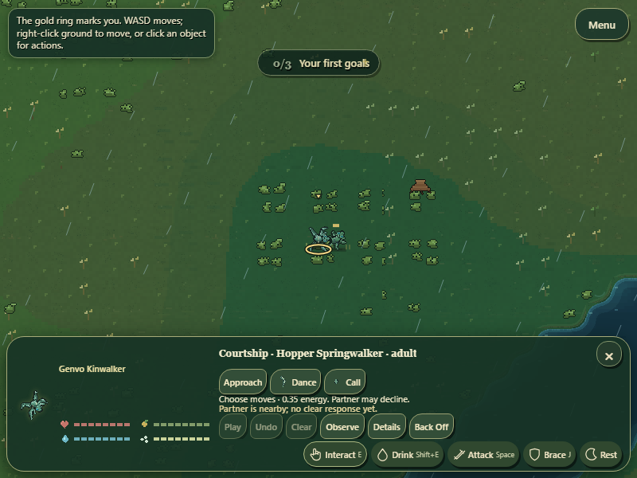
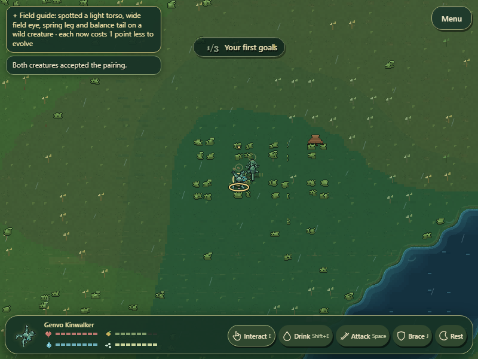
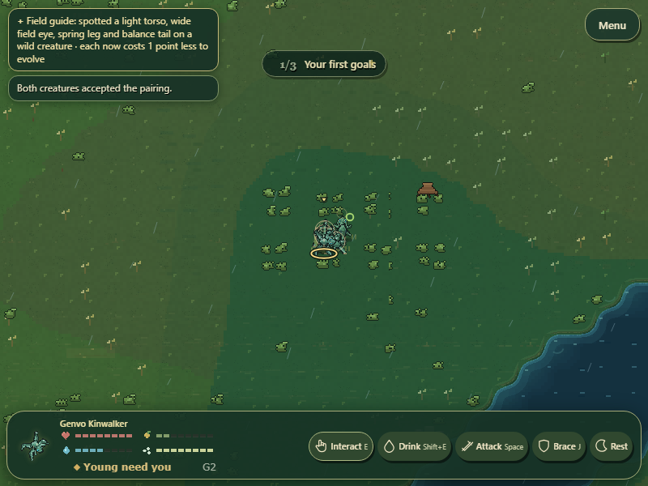

# GenVo — Emergent Reproductive Compatibility & Hybrid Lineages

Dedicated-loci integration is implemented as a **development model**, following the creator's attached framework and explicit choice of dedicated inherited reproductive loci. World Trails remains complete as its own checkpoint. This pass does not settle numerical fertility balance, prove naturally evolved reproductive isolation, or remove every founding-profile biological assumption.

## Substantial gameplay change

Mate discovery, biological eligibility, autonomous partner search, courtship rivals and conception no longer reject a pair solely because its founding species IDs differ. Generated taxon names also no longer impose a universal mate-search preference. Actual individual preferences, reciprocal acceptance, kinship, age, health, reserves, recovery, maternal anatomy and existing carrying checks remain separate authorities. Each partner uses its own current founding-profile maturity/energy limits; gestation and funding use the gestating parent's profile instead of whichever actor called tryMate.

Animals now carry a bounded, diploid reproductiveGenome with two dedicated loci. Gamete matching determines conditional pair potential; the development-locus alignment determines the individual's fertility contribution. Neither reads body layout, survival-gene distance, preferences, generation count, species IDs or generated names. All new founders and missing legacy fields receive the same neutral ancestral baseline, preserving viable existing pregnancies without inventing label-specific infertility. This is a deliberate compatibility-preserving initial condition, not evidence that arbitrary real organisms can hybridize.

A newborn inherits one allele per locus from each actual conception parent, with deterministic per-child segregation/mutation and bounded provenance recording parent ID, source allele and mutation delta. Parent snapshots freeze these records for live birth and eggs even if a parent dies or changes later. Existing body-plan crossover, survival-gene inheritance, optional body mutation and finite offspring funding produce actual descendants. Paternal player lineages remain controllable when the gestating parent has a different founding ID. Matching physical configurations preserve the editor opportunity after successful conception; mixed configurations recombine through the existing body authority.

Reciprocal acceptance is distinct from conception. An accepted attempt may fail to form a pregnancy; the observable result says both accepted and no pregnancy formed, rather than claiming rejection. Such an attempt funds no brood, records the actual conditional biological result, retains successful optional ritual learning and uses the existing eight-day mating recovery cadence to prevent per-frame conception rerolls. No preference chances, consent draws or hidden numerical preferences are exposed on the main HUD. Advanced mate inspection can read the conditional model and actual loci.

Existing speciation names remain descriptive. Its historical low-cross-birth statistic is now described as **observed gene-flow separation/local-only birth share**, explicitly distinct from biological infertility. An existing hybrid can have positive compatibility with two otherwise separated genotypes; names never lock that connection.

## Numerical model is provisional

The implementation reuses the existing scalar allele domain [0.72, 1.28] and CFG.heredity.mutation (currently ±0.045), with one shared domain definition. Affinity is linear across that domain; gamete affinity averages the four possible parental allele pairings, and intrinsic fertility uses development-locus alignment. Conditional conception potential is their product. At matching ancestral values the biological factor is 1; actual consent/readiness/kinship/resources are still required. There is no generation timer, name threshold or invented species-distance cutoff. These formulas are inspectable development hypotheses, not a scientifically validated chromosome model or creator-approved final rates. No embryo lethality rule was added.

A controlled genetic-only probe used four seeds, two 16-member cohorts and 32 inheritance rounds. Final mean cross-cohort potentials ranged 0.331–0.539, while within-cohort potentials also fell (roughly 0.352–0.643). This exposes a material calibration issue: neutral divergence can reduce fertility within a population as well as between populations. It must be evaluated under real reproductive selection before choosing final mutation/affinity behavior. The probe bypasses consent, kinship, survival and funding and is **not natural population-evolution evidence**. See reproductive-divergence-probe.json. Complete/partial infertility and a hybrid bridge were separately verified with legal controlled locus variants.

## Changed gameplay source

Sixteen modules differ from the delivered World Trails source. hybrid-lineages-source-changes.json records the prior archive and changed modules.

| Modules | Purpose |
| --- | --- |
| src/reproduction/reproductive-compatibility.js | Single read-only compatibility calculation, dedicated allele validation, ancestral defaults and traceable parental inheritance; no competing conception controller |
| src/organisms/species.js, src/lineage/heredity.js | Share the existing allele domain; allow real lineage inheritance across founding IDs rather than a genvo-only parent gate |
| src/sim/simulation.js | Integrate loci at spawn, shared availability and conception; remove class-only partner exclusion; distinguish acceptance/fertility; use the maternal profile; preserve cross-founding family control |
| src/reproduction/reproduction.js, src/reproduction/partner-encounters.js | Search/select through shared compatibility and each partner's physiology; remove descriptive-taxon priority |
| src/reproduction/courtship-performance.js | Rivals use actual pair validity; culturally observed legal performances are not blocked by founding labels |
| src/ecology/gestation.js, src/persistence/save-manager.js | Freeze loci in parental snapshots, persist them, neutrally migrate missing fields and reject invalid saved allele data without consuming RNG |
| src/lineage/body-inheritance.js, src/lineage/evolution-editor.js | Match actual physical graphs across founding IDs and preserve existing editor/crossover rules |
| src/lineage/lineage.js | Retain the descendant's inherited reproductive genome in lineage records |
| src/lineage/speciation.js | Distinguish observed gene-flow separation from infertility in descriptions; recognition never controls compatibility |
| src/ui/courtship-observation.js, src/ui/inspector.js, src/ui/journal.js | Observable accepted-without-conception outcome; conditional advanced evidence; cross-founding physical breeding guidance |

## Real runtime verification

**Controlled native Chromium, 800×600:** existing GenVo and Hopper actors, legal original anatomy, adulthood/reserves/sex/positions staged on real shared land. The mouse selected the partner, opened Court, played actual Approach performances and received real reciprocal acceptance after bounded attempts. No preferences, consent draws, conception chance or RNG were overridden. Mixed physical builds did not offer the editor. The resulting pregnancy paid 31.96 reserve investment; the existing funded birth authority was invoked to inspect four actual newborns without claiming naturally elapsed gestation. All four had valid different recombined graphs, both actual parent IDs, and dedicated inherited alleles with causal receipts. Native screenshots and continuous video were inspected; save/load preserved all 200 actor genomes. Receipt: hybrid-lineages-proof.json. Initial capture errors were fixture selection/input issues: a swimmer could not be caught by a land-bound player, and completed encounters correctly auto-collapsed. Reachability and controller validity were preserved while correcting the fixture.

**Separate natural observation:** 120 wall-clock seconds at ordinary game speed, fresh generated world, only Auto and Keep the old body UI choices. No actor/anatomy/readiness/resource/clock/RNG edits. Simulation reached tick 969 and recorded three births. No cross-founding hybrid or accepted-but-unconceived result was recorded in this bounded observation. This does not establish natural hybridization, multigenerational isolation, hybrid survival/fertility balance, or first-time human comprehension. Receipt: natural-hybrids-proof.json.

**Focused checks:** 15 suites passed, covering the new model, actual cross-founding conception/birth, paternal lineage continuity, matching-build editor opportunity, genuine preference/biological separation, accepted-but-unconceived recovery/no brood funding, partial/complete infertility, a hybrid bridge, frozen conception snapshots, legacy migration/invalid-save rejection, existing physical breeding, eggs, save continuity, courtship/rivals/reciprocal partner behavior, lineage, observed feedback and World Trails. Availability reads preserve RNG and actor state. Source audit: 179 source modules, 175 reachable runtime modules, 79 native parts, no duplicate source authority.

Four suites fail in both this source and the exact delivered World Trails source extracted separately: maternal-birth-authority, birth-reserves, birth-hydration (existing supported-habitat fixture failures), and evolving-courtship-rituals (its existing bounded conception assertion). No assertion was skipped or biological gate weakened. Their exact current/prior outputs are in reproductive-compatibility-test-receipt.json. This is not a full-suite-green claim.

## Remaining work and next substantive milestone

Calibrate dedicated-locus inheritance and fertility under real multigenerational selection, particularly within-population fertility and hybrid gene-flow recovery, before treating rates as final. Audit/replace inherited life-history and wildlife behavior assumptions still taken from maternal founding metadata. Existing wild speciation recognition and several lineage ecology subsystems still have genvo-specific scope; this pass does not pretend those are removed. Natural reproductive isolation, broad evolved-body combinations, ecological balance, creator visual approval and human playtesting remain open.

The next substantial pass should connect that calibration to real lineage physiology/offspring survival and remove the remaining profile-based biological authority, while preserving the now-integrated mouse, trails, courtship and funded birth foundations.

[Continuous controlled runtime recording](hybrid-lineages-runtime.webm) · [Separate natural observation](natural-hybrids-runtime.webm)
