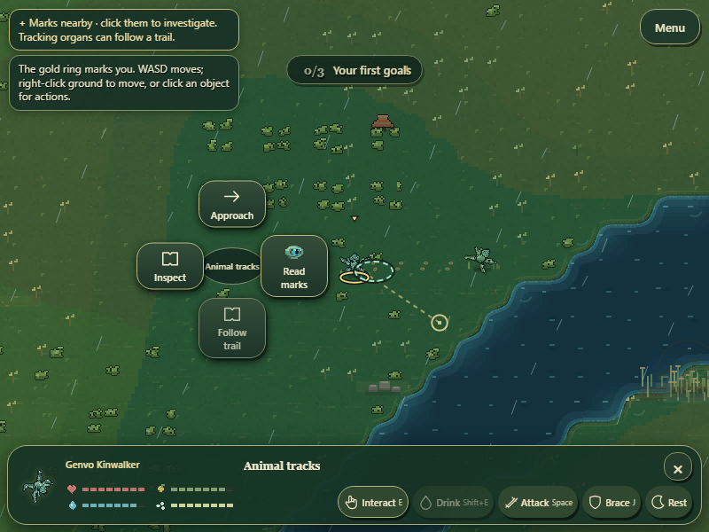
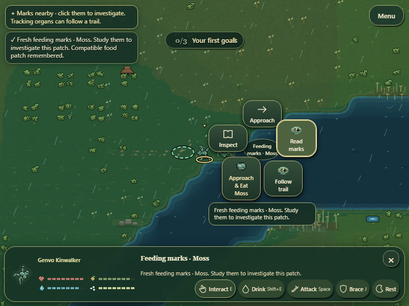

# GenVo — World Trails

Substantial implementation milestone complete as a development checkpoint. This advances anatomy-driven discovery and activities between generations. The broader evolutionary roadmap remains open; no creator visual approval, human comprehension, ten-minute engagement or ecological balance claim is made.

## What the player can now do

Animals leave temporary impressions after real movement and feeding. The player can click visible marks, Read marks, investigate the feeding patch, and use lawful contextual Eat actions when the actual resource and their current diet permit it. A successful study of compatible feeding evidence adds to the creature's existing foraging patch memory and cognition record. It does not consume food, fill needs, award mutation points, count toward the four-food trial or reveal unseen body parts. Carnivores may read plant evidence while receiving an explanation that their mouth cannot use that food.

A mounted organ with the existing track capability enables Follow trail. It chains newer visible marks left by the same source through ordinary mouse navigation, terrain checks and movement energy expenditure. The selected evidence and radial menu persist during travel. Manual movement, new selection, dismissal, Rest or defense can stop it; blocked/interrupted routes end tracking with feedback. At the end it says the visible trail ends. It never jumps to the source animal's current hidden location or silently substitutes an unrelated resource. This is a new exploratory survival activity, rather than a navigation button rearrangement.

Actual mounted limb presence and body mass shape paired impressions or body-drag marks. Water disturbance fades sooner; feeding evidence remains longer. Marks are capped and expire in simulation time, so pause does not age them. Reading produces a brief existing ground-investigation body pose oriented toward the evidence. No new creature template, fixed species dispatch or simulated biological outcome was introduced.

## Source changes

Seventeen gameplay modules differ from the previously delivered Embodied Encounters source ZIP; `world-trails-source-changes.json` records the comparison.

| Modules | Purpose |
| --- | --- |
| src/gameplay/discovery.js | Own real trace receipts, lifetime/sensory visibility, anatomical action validity, study consequences and bounded same-source following |
| src/ecology/history.js, src/cognition/cognition.js, src/sim/simulation.js | Record evidence from existing successful movement and feeding events; retain original ecology and behavior authority |
| src/ecology/freshwater-food.js | Include the consumed source cell in the existing freshwater meal receipt, so shore feeding marks appear at the food source |
| src/gameplay/foraging.js | Share the actual terrestrial/freshwater diet selector and pass real meal coordinates; keep finite feeding and patch-memory ownership |
| src/gameplay/interaction-command.js | Present and execute canonical study/follow actions and exact-source feeding through the same command path used by E and the dock |
| src/ui/world-resource-target.js, src/ui/creature-context-tray.js, src/main.js | Select visible evidence, retain context while following and connect each trail leg to existing navigation; manual takeover cancels it |
| src/ui/pointer-approach.js | Execute a pending interaction when its authoritative reach check becomes valid; clear interrupted/blocked routes safely |
| src/ui/action-icons.js, src/ui/context-radial.js | Show mounted sensing/tracking art and keep long explanations above the bottom dock at 800×600 |
| src/render/world-traces.js, src/render/renderer.js, src/render/behavior.js | Read-only visible mark drawing and actor-owned investigation pose; preserve shared native creature rendering |
| src/persistence/save-manager.js | Preserve real evidence/learned patches in snapshots; clear ephemeral follow routes on reload |

## Runtime evidence

**Controlled browser workflow, 800×600:** existing actors and positions/readiness staged, with a validated tracker-eye graph variant. Marks came from the actual movement phase and real resource consumption, not injected traces. Default sensing eyes could Read marks but could not Follow trail. Tracking anatomy then physically followed a bounded trail; ArrowLeft immediately cleared the route and session, and mouse selection successfully resumed it. A real meal left source-specific feeding evidence; Approach & Read executed when canonical reach became valid and remembered the compatible patch. Save round-trip retained evidence/study records and cleared the unsaved navigation session. No page errors were recorded. The final capture learned Moss; an earlier controlled capture also exposed and verified the corrected algae/freshwater compatibility path. Receipt: `trail-discovery-proof.json`. Continuous native video and temporal frames were inspected; no art or human-usability approval is inferred.

The existing complete contextual-command browser workflow also passed after this integration: herbivore/carnivore/omnivore/specialized feeding, exact-target restrictions, water, care, combat, defense and saves. The complete-dock workflow passed earlier in this pass. Source audit passed: 178 source modules, 174 reachable runtime modules, 79 registered/native parts, no duplicate source authorities.

**Separate unstaged observation:** 120 wall-clock seconds in a fresh generated world at normal speed, using only the ordinary Auto toggle. No actor/anatomy/readiness/resource/RNG/clock edits. Movement and feeding marks appeared naturally, with 3–14 locally visible marks in sampled frames and a real nearby-evidence hint. The player stayed alive, paired through existing courtship, and reached the existing generation editor at tick 816/day 18; that modal paused simulation for the remaining observation. The last sample contained 1,317 active world marks, including 74 feeding marks, with 10 visible to the player. No offspring or natural player trail-study was observed. This proves ordinary trace production in a bounded run, not a complete first ten minutes or natural manual discovery success. Receipt: `natural-trails-proof.json`.

Focused tests passed for trace provenance, read-only queries/RNG, valid anatomical tracking, non-omniscient endpoints, incompatible mouth explanations, no eating/mutation reward for reading, expiry/no fallback, save behavior, authoritative early reach, pause/manual interruption, blocked routes, original dietary/water/contextual actions, courtship, resource poses, notification feedback and held defense. No assertion was skipped or biological validation loosened. Two older failures recorded in the modular-head review remain historical limitations; this focused pass is not a full-suite certification.

## Limitations and next milestone

Marks are stylized surface evidence, with finite sensory range and retention; crowds or faded gaps can end a trail. Calls, scent trails and inference about witnessed social behavior are not implemented by this slice. Meat evidence remains inspectable/trackable with canonical feeding when valid, but does not create a separate invented meat-patch memory system. Creator visual approval, all evolved-body combinations and unfamiliar-player comprehension remain open. Existing fixed founding-species biological assumptions have not all been removed.

Next substantial priority: phenotype-driven wildlife and reproductive encounters. Replace remaining redundant species-class gates through existing biology authorities while preserving saves, kinship, anatomy and genuine mate choice. A new inherited reproductive-isolation model needs a concrete creator decision rather than silently authored rules. The finished interaction/trail foundations should not be repeatedly repackaged as a new feature.

[Continuous controlled runtime video](world-trail-discovery-runtime.webm) · [Separate unstaged observation](world-trails-natural-runtime.webm)
