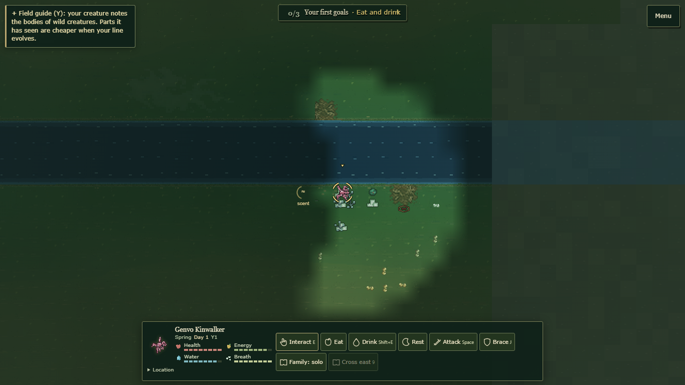
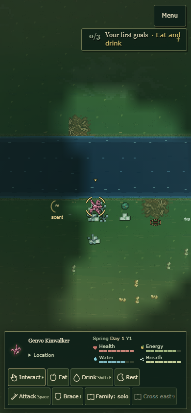

# Survival HUD and feedback presentation

The existing survival HUD now shows its native condition labels and season/day clock. Raw coordinates are retained in their original DOM element behind a native Location disclosure. Actions, availability, disabled explanations, notification channels and protected-action overlay placement keep their existing owners. Styling uses the same natural-history palette, type and restrained borders as the integrated menus and lineage interfaces. No biological, event, controller or save policy changes.

## Verification before latest-biology merge

Eleven focused UI, placement, notification, action, render and public-export checks pass. The canonical source audit passes. The unchanged ignored sprite-reference manifest was copied from the original checkout for the audit; runtime assets are unchanged. Normal public export includes 833 files and 410 module/dependency entries.

The exported game is served directly without source overlays or inspection hooks. Public New World/onboarding, held movement, actual water/ground targets, native context controls and a requested/dismissed Field Guide are exercised. The strict browser pass has 36 cases across 1920x1080, 1366x768, 1024x768, 800x600 and 390x844: defaults, explicit UI-only notification fixtures, four screen edges, open-menu resize, visible labels/clock and optional coordinates. No tested HUD/menu/notice covers protected player/target bounds or leaves the viewport. Complete saved-state graph remains exactly equal across synchronous stylesheet toggling and native dock redraw. Geometry checks support inspected real-runtime frames; they do not establish creator acceptance.

The phone layout was refined from 215 to 159 pixels in height while retaining all native action buttons. These are candidate-to-final measurements, not a claim that every old HUD layout was taller. Desktop labels/clock add useful information; overall v1 minimal-HUD acceptance remains open.

## Actual stale-world portrait defect

Three public seeded worlds are created in one running application using native Pause/Return Without Saving/New World controls. PLANET-B0-A and GENVO8-TEST-A reuse actor ID 109 and body-plan ID bp0-4134709b. The old dock cache retained the first world's pink pigment even though the next world expressed brown, giving zero expected skin pixels. Location also stayed open from the previous world.

The cache now has a Simulation object owner. A changed owner invalidates only drawing state and closes the ephemeral disclosure. The current actual genomes yield 639, 739 and 635 native skin pixels across the three real worlds; all Location disclosures start closed. This consumes canonical phenotype/palette readings, not a new pigment formula. Numeric native-art revision reads avoid allocating status objects in the display loop.

## Evidence limits and harness corrections

The initial public P capture opened the actual pause navigator and was rejected as gameplay evidence. Another candidate lookup queried the document after the HUD had been detached, leaving coordinates outside the disclosure; visual inspection caught it and the local-parent lookup was corrected. Bounding-box size was replaced by rendered visibility for closed native details. Snapshot imports now complete before the before-reading, preventing an asynchronous module request from allowing ordinary simulation steps between readings. Original failures are retained in the raw archive; assertions and native behavior were not weakened.

Notification bursts explicitly say UI layout fixture; they are not claimed as ecological events. Ordinary frames preserve actual native discoveries/status. Full survival, ecology, GPU performance, every evolved anatomy, notification-capacity extremes, dense encounters and creator acceptance are not established by this pass.

## Reproduce

Use the ordinary public exporter. Run `node tools/review-survival-presentation.cjs <export> <new-report> --strict --edges` and `node tools/verify-survival-world-switch.cjs <export> <new-report>` sequentially. These are presentation integration checks, not replacement biological gates. The preserved source patch is an integration record; do not reapply it to active source. The original repository remains the fallback, and no migration, push or release is performed.
