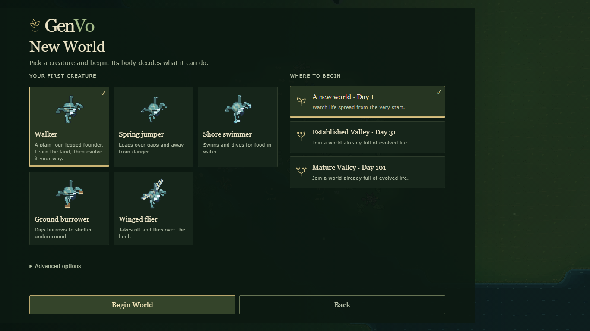
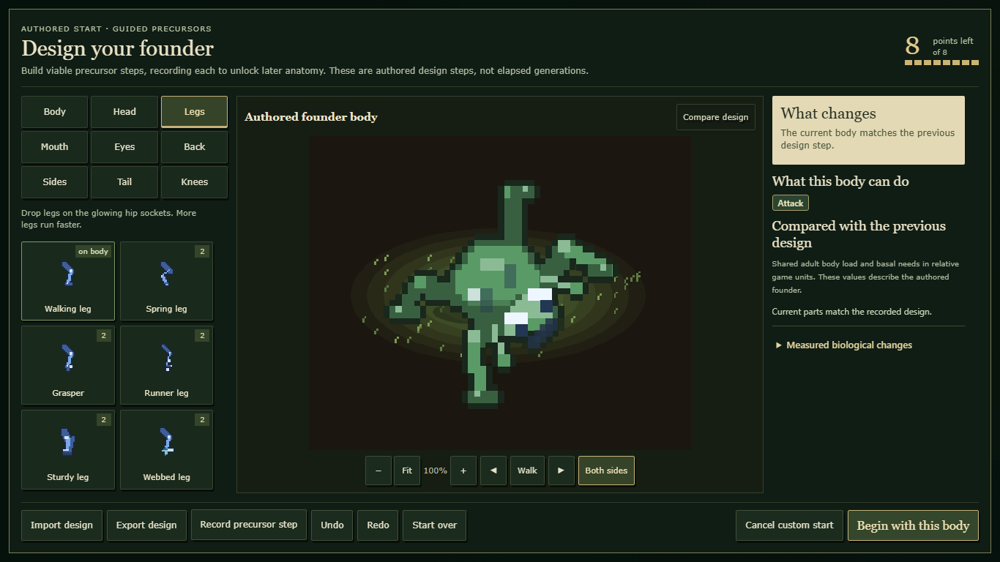
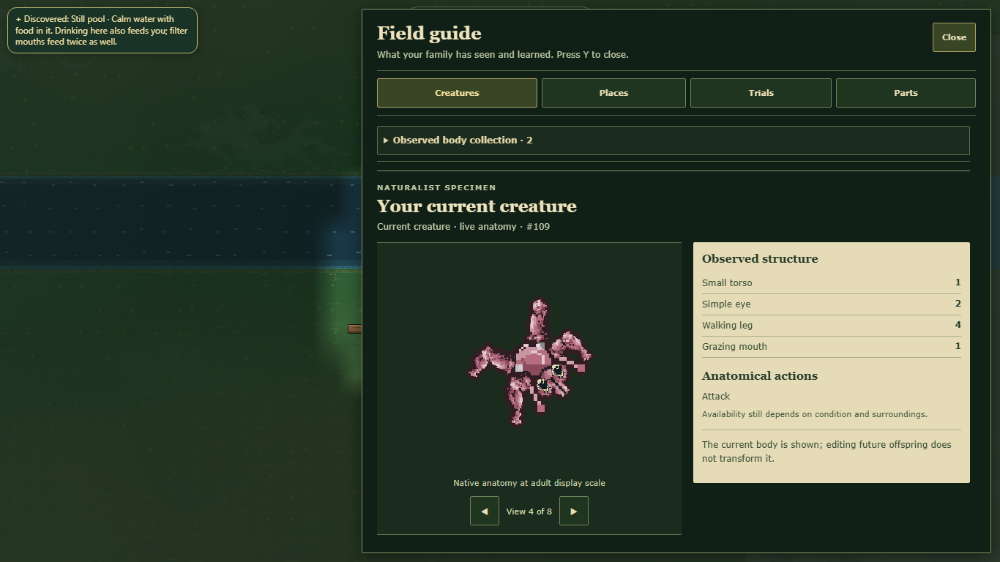

# Integrated menu, Creature Lab and specimen presentation

The prepared natural-history presentation is active in source: illustrated menu/start choices, responsive Lab workspace and a native specimen sheet. The existing seed input now sits inside Advanced options. Checkpoint cards use their actual catalog days and the recorded-lineage label. The Lab label correction keeps capability and comparison headings separate. Observe retains its native discovery call and opens the actual retained specimen. Current bodies and retained examples keep distinct presentation keys.

## Evidence on 4169c22 plus presentation integration

- 103 playable-gate checks pass (747.63 seconds), plus 12 focused editor/founder/menu/specimen/action/export tests.
- Five canonical starter-plan assets pass exact-plan, distinct-image and local-dependency checks. Canonical source audit passes. The audit initially lacked an ignored derived reference manifest in the isolated checkout; copying the original unchanged resolved it. Both outputs are retained.
- Normal public export: 831 files, 409 module/dependency entries. No proposal overlays or inspection hooks are used in these browser runs.
- Five-size New World review checks selection, scrolling, real checkpoint choices and loaded assets. Public Space/Begin World/Enter/WASD creates and moves in the actual requested seeded world.
- Five-size Lab review uses native guided-founder controls, legally mounts paired spring legs, exports the design and verifies the exact same plan installed in the authored world. Official 30-second clock and fasting-1 policy are recorded on this checkpoint, not changed by presentation.
- Specimen review uses genuine sensory observations, public right-click Observe, retained native anatomy, exact canonical snapshot parity, eight facings, four guide tabs, five viewports and native close/reopen. No biological event or observation is fabricated.

Desktop and phone menu, Lab and specimen frames were inspected. Four parallel final browser launches timed out during initial load; all terminated and were rerun sequentially with unchanged product code, assertions and timeouts. Sequential runs pass. An earlier keyboard test required waiting for native asynchronous menu readiness before the unchanged Space-selection assertion. These are harness limits, not renderer acceptance or measured whole-game performance.

## Reproduce and remaining work

Use the ordinary `tools/export-public.mjs`, then `tools/review-natural-history-menu.cjs <new-report> --exported <build>`, `tools/verify-menu-presentation.cjs <build> <new-report>`, `tools/verify-lab-presentation.cjs <build> <new-report>` and `tools/review-natural-history-specimen.cjs <new-report> --candidate-only --modern --exported <build>` sequentially.

Selected review build: `C:\Users\jackt\AppData\Local\Temp\genvo-interface-v1-web-20261023-final`. Original raw outputs and unsuccessful runs are retained in the original repository under `reports/art-session-20261023-interface-v1-raw`.

This implements the prepared presentation, not complete menu/Lab/inspector acceptance. Existing CSS layers still require consolidation with the shared owner; broad behavior previews, dense collections, individual live telemetry, map, HUD/notices, audio, GPU performance and unfamiliar-player/creator acceptance remain open. Source migration and release are not performed or approved here. Historical proposal receipts remain unchanged. Later merged biology and combined-source checks are recorded separately below.
