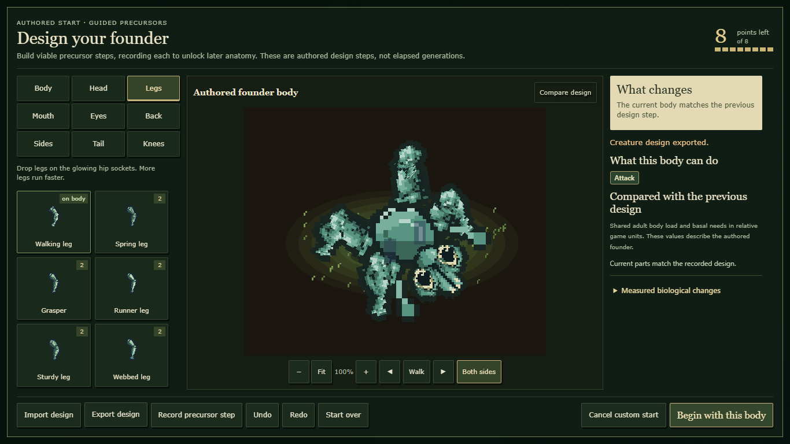

# Integrated menu, Creature Lab and specimen presentation

The prepared natural-history presentation is active in source: illustrated menu/start choices, responsive Lab workspace and a native specimen sheet. The existing seed input now sits inside Advanced options. Checkpoint cards use their actual catalog days and the recorded-lineage label. The Lab label correction keeps capability and comparison headings separate. Observe retains its native discovery call and opens the actual retained specimen. Current bodies and retained examples keep distinct presentation keys.

## Evidence on 4169c22 plus presentation integration

- 103 playable-gate checks pass (747.63 seconds), plus 12 focused editor/founder/menu/specimen/action/export tests.
- Five canonical starter-plan assets pass exact-plan, distinct-image and local-dependency checks. Canonical source audit passes. The audit initially lacked an ignored derived reference manifest in the isolated checkout; copying the original unchanged resolved it. Both outputs are retained.
- Normal public export: 831 files, 409 module/dependency entries. No proposal overlays or inspection hooks are used in these browser runs.
- Five-size New World review checks selection, scrolling, real checkpoint choices and loaded assets. Public Space/Begin World/Enter/WASD creates and moves in the actual requested seeded world.
- Five-size Lab review uses native guided-founder controls, legally mounts paired spring legs, exports the design and verifies the exact same plan installed in the authored world. Official 30-second clock and fasting-1 policy are recorded on this checkpoint, not changed by presentation.
- Specimen review uses genuine sensory observations, public right-click Observe, retained native anatomy, exact canonical snapshot parity, eight facings, four guide tabs, five viewports and native close/reopen. No biological event or observation is fabricated.

Desktop and phone menu, Lab and specimen frames were inspected. Four parallel final browser launches timed out during initial load; all terminated and were rerun sequentially with unchanged product code, assertions and timeouts. Sequential runs pass. An earlier keyboard test required waiting for native asynchronous menu readiness before the unchanged Space-selection assertion. These are harness limits, not renderer acceptance or measured whole-game performance.

## Reproduce and remaining work

Use the ordinary `tools/export-public.mjs`, then `tools/review-natural-history-menu.cjs <new-report> --exported <build>`, `tools/verify-menu-presentation.cjs <build> <new-report>`, `tools/verify-lab-presentation.cjs <build> <new-report>` and `tools/review-natural-history-specimen.cjs <new-report> --candidate-only --modern --exported <build>` sequentially.

Selected review build: `C:\Users\jackt\AppData\Local\Temp\genvo-interface-v1-web-20261023-final`. Original raw outputs and unsuccessful runs are retained in the original repository under `reports/art-session-20261023-interface-v1-raw`.

This implements the prepared presentation, not complete menu/Lab/inspector acceptance. Existing CSS layers still require consolidation with the shared owner; broad behavior previews, dense collections, individual live telemetry, map, HUD/notices, audio, GPU performance and unfamiliar-player/creator acceptance remain open. Source migration and release are not performed or approved here. Historical proposal receipts remain unchanged. Later merged biology and combined-source checks are recorded separately below.

## Combined committed biology checkpoint

Committed biology through `03eb672` was merged intact in `3990471`, including need-driven activity, tissue-energy/1 and metabolism/fasting-2. Twelve combined focused checks and the canonical source audit pass (404 source modules, 396 runtime-reachable source modules). The normal public export has 832 files and 410 module/dependency entries. Canonical uncommitted perennial-regrowth work is excluded.

The older Lab verifier correctly failed its obsolete fasting-1 expectation on this newer checkpoint. Its contract is updated to the fixed literal `metabolism/fasting-2`, citing the committed body-reserve policy and regression; it still requires the exact authored plan, origin, clock and biological policy. A proposal to derive the expected policy from implementation was rejected by automatic review and never executed. No biology, budget or test outcome was weakened.

## Genuine native-art arrival correction

Review exposed a real presentation defect: opening the Lab before native assets arrived left isolated-part thumbnails and full-body extents cached from fallback art. The shared renderer already published revisions, but the Lab did not consume them. The Lab now clears its isolated cache on revision, recomputes preview bounds for that revision and repaints existing stage/parent/thumbnail canvases. It preserves the actual DOM controls, focus, draft and biological state. The display loop reads a numeric revision getter without allocating per-frame status objects; it repaints only when the revision changes.

`tools/verify-lab-art-arrival.cjs <export> <new-report>` delays only the original catalog request and then continues its response unchanged. On the pre-fix export, the unchanged thumbnail condition times out after catalog readiness. On the corrected export all 97 native parts load; thumbnails, comparison parent and stage update automatically, control identity/focus remain intact, and exported design plus complete simulation graph are exactly equal. No artificial pregnancy, anatomy or organism event is used. Nine focused editor/native-art/portrait/export checks and a new five-size exact-authored-world browser run pass. Loaded-art desktop and phone frames were inspected.

Current combined review build with the correction: `C:\Users\jackt\AppData\Local\Temp\genvo-interface-v1-web-20261023-art-refresh`. The earlier exports remain historical before/integration evidence. The full gate was started before this presentation-cache correction; separate cache-specific checks and browser proof cover the changed drawing path.

## Final integration gate

The combined committed-biology/presentation gate completed successfully: **105 checks**, exit 0, 905.5 seconds. The gate started before the final Lab drawing-cache correction; nine focused checks plus direct pre-fix failure/post-fix pass and five-size native-art browser proof cover that later drawing path. Twelve additional combined tests, the final source audit, seeded manual movement, exact authored-body installation, public Observe and genuine first-young/Journal review pass. These establish bounded automated/browser evidence, not complete gameplay, GPU performance, creator approval or migration/release acceptance.
