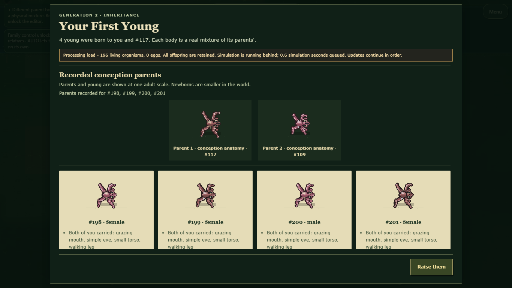
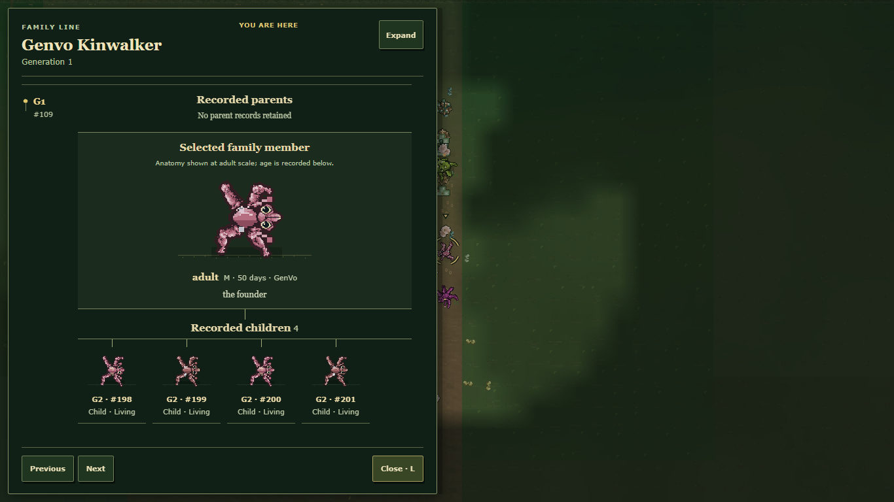

# Integrated portrait and lineage presentation

The coordinated change is active in runtime source. Family Journal and first-young layouts now use the prepared presentation assets. Portraits use the canonical phenotype RGB palette and the actual retained conception or live pigment genome. Shared native full-gait bounds are cached for fitting and drawing. Missing pigment keeps the existing legacy expression path. No reproduction, survival, persistence or migration rules change.

The checked-in handoff preceded shared-file edits. Its retained patches are integration history, not outstanding work or patches to reapply. Earlier proposal receipts remain unchanged.

## Automated verification

The full `tools/check-playable.mjs` gate passed all 103 checks in 785.23 seconds (exit 0). This gate ran on committed wildlife baseline a000bfe plus the integrated presentation changes; concurrent uncommitted biology work was excluded. Nine additional focused tests pass against integrated source: portrait-pigment-reading, lineage-comparison, young-summary, birth-comparison, generation-reveal, succession-selection, resident-start, inherited-pigmentation and native-inherited-pigment. The canonical source audit passes with 403 source modules and no missing/duplicate source errors. The normal public exporter includes 830 files and 408 source modules.

## Browser observation

The ordinary exported app was served directly, without proposal overlays. Public New World, AUTO, native speed and Keep old body led to a genuine four-young litter on Day 19. No pregnancy, age, reserves, genome, birth or clock was forced. All five window sizes passed layout, native pause/dismiss and complete snapshot parity checks. The processing-capacity notice remained visible in the dialog and returned to its original owner on dismissal. No page errors or missing requests occurred.

All six conception-parent/newborn portraits contain their expected canonical RGB skin pixels (1043-1204 each); the selected Journal record contains 4306. Six cached readings/bounds remain six after repeated comparisons. Warm paused comparison samples are 1.0-2.3 ms in headless Chromium, not GPU, whole-game performance or creator acceptance.

Desktop, phone and Journal screenshots were visually inspected. The receipt retains the complete native state readings and test limits.

## Reproduce and limits

Use `node tools/export-public.mjs <new-empty-directory-outside-source>`, then `node tools/review-natural-history-young.cjs <new-evidence-directory> --exported <build> --portrait`.

Selected actual-source review build: `C:\Users\jackt\AppData\Local\Temp\genvo-portrait-v1-web-20261023-integrated`. Raw evidence belongs in `reports/art-session-20261023-portrait-v1-raw` in the original development repository. Menu/Lab/specimen activation, all-body acceptance, GPU review, broader UI/audio work and the complete GenVo v1 goal remain unfinished. No push, migration, release or creator approval is claimed.
