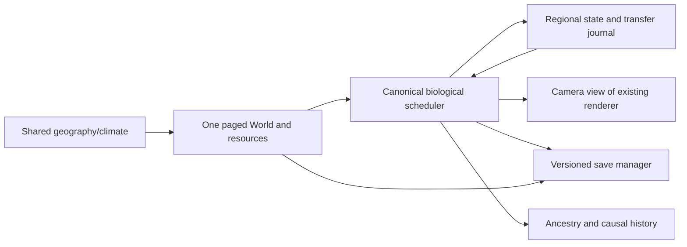

# Continental Living Planet and evolutionary possibility space

Current-state notice: this document retains historical review/baseline statements. The current A-H and LP-1 through LP-7 status is mapped in CURRENT-ACCEPTANCE-MAP.md. Earlier topology/birth-cap/directed-inheritance failures have bounded repairs and newer receipts; the full milestone remains incomplete. Older fast fingerprints and100-day trials are not current full-objective acceptance.

October 17, 2026. **Reviewed: A0 and A authorized; larger-world implementation remains behind the next review checkpoint.** This incorporates the three latest creator notes about evolutionary potential, continental architecture and the open-ended biological possibility space. It expands the original First 100 Days objective without dropping its biological, player, performance or save requirements.

The game defines what biology can do, not what evolution must produce. The creator supplies mechanisms and compatible possibilities; the simulation supplies history. Complexity, diversification, convergence, persistence of simple organisms, simplification and extinction are all possible. The ancestor is not a concealed finished blueprint for every future animal.

## Review decision and current baseline

Historical pre-review baseline (superseded for A0/A by REVIEW-DECISIONS.md): “No new feature implementation until the plan is reviewed.” Review the coordinate/ownership contract, biology migration, jam scope and ordered passes before authorizing implementation. No giant map, creature-class library or replacement renderer is the next action.

Uncommitted regional-climate/depth/salt and terrain-travel work predates that instruction. It remains a prototype. Focused regional-environment, terrain-travel, movement-parity, topography and soil-water checks pass. **The pre-A0 baseline failed surface-water-persistence** when an existing test changes a water mask without corresponding depth/salt state: `Environment water topology mismatch` during restore. Preserve that failure and repair the atomic topology contract; do not weaken validation or delete the test. No new full gate, browser acceptance or extended soak certifies this prototype. Prior 384-pass/100-day receipts and screenshots predate these changes.

## Current-system gaps and canonical ownership

| Existing authority | Keep | Gap / required migration |
| --- | --- | --- |
| World, terrain, weather, soil-water | Deterministic generation, conserved buckets, persistent weather | Global coordinates/pages, coherent continents/lakes/watersheds, seam flux. Local prototype coast is imposed, not continental generation; surface salt does not model saline soil/groundwater. |
| Renderer/indexed modular art | Existing top-down art, assembly, cached terrain, batching | Replace fixed world-size assumptions with bounded view pages/halos; no renderer replacement or art-style change. |
| Simulation/spatial queries | Phase order, individual state, reproduction, food/cognition/family | Global identities/positions and region indices/scheduler; global scans and flat n*n arrays cannot simply grow 20-fold. |
| Activity/distant cadence | Existing stride compensation and interaction parity | Not a persistent continental ecology model. Camera-based cadence may change outcomes; any approximation requires measured error and conservation. |
| Regional ecology/migration | Histories and movement intentions | Region history owns no duplicate stock/births. Add exact-once cross-region transfers to current World/Simulation, not a second biology engine. |
| Part/body grammar | 79 IDs, eight sockets, graph and mirrored inheritance | Segment duplication/loss, alternative organization and functional viability instead of mandatory four legs/eye. [Exact catalog audit](PART-CATALOG-GAPS.md). |
| Part effects/mass/tissues | Existing consumers and draft tissue inventory | Live mass is species-based; reviewed tissue-derived costs must replace contextual normalization without duplicate charges. Metadata mass and calibrated live mass are different. |
| Inheritance/reproduction | Parental recombination, funded births, compatibility, preferences | Remove directed useful mutation and relic-only natural origins; permit reduction/loss; keep hybrid fertility and provenance. Reward points cannot buy impossible structures. |
| Flora/resources | Finite stocks, genotype-bearing propagation, shared demand | Chunk stocks, seam flux and thermal/salt/canopy response; real marine production. No second plant engine. |
| Physiology | Existing energy/hydration/exertion and water access | Shared heat/oxygen/osmotic/buoyancy/air mechanics. Player-only exposure, gill refill and membrane sprint bonuses do not satisfy these. |
| Persistence | Save manager, codecs, typed/Map state | Versioned generator/rules, regional state, transfers, scheduler and global IDs; never reinterpret old arrays by changing worldSize. |
| Founding/progression | Resource-informed starting stocks, family journey | Normal young mode needs simple ancestors. Advanced founders lack recorded ancestry. maxAnimals currently clips newborn slots: CPU capacity must not masquerade as biological selection. |

Existing Claude handoffs were inspected in the preceding audit. They are historical records, not live work authorization. No new parallel feature work or chat messaging was started. Re-read shared module diffs before editing; preserve earlier work and backups. Existing design/governance/implementation-authorities.json and physical-mass proposals remain ownership references.

## 1. Coordinates, regions, chunks and connected travel

Extend **one World authority** with paged access; chunks are pages, not independent simulations. Use signed safe-integer global tile coordinates, continuous organism world positions and local drawing coordinates. Floor division/modulo must work for negative positions; cross-boundary reads must not clamp into an edge tile.

Proposed first page: 64x64 tiles; ecological region: 2x2 pages. These are measurement candidates, not biological rules. Chunk identity is `(planetId, generatorVersion, cx, cy)` plus field revision. Stable entity IDs survive migration. Preserve existing numeric IDs under a legacy-world namespace; new identities derive from collision-checked birth-event tuples (parents, conception serial, litter index), independent of camera/load order.

The existing renderer requests camera pages plus a halo. Neighbor sampling crosses seams for terrain, rivers, habitat smoothing and paths; cache keys include world/chunk revision and scale. Prepare visible pages before showing an arrival frame, reusing existing startup preparation. Rendering can unload while biology persists. No pop-in, random repopulation or deletion of offscreen wildlife is accepted as an optimization.

Travel remains continuous. Long routes use regional portals/corridors, then actual local steps use the same movement/energy/habitat validator. Cross-region combat, mating and food access use halo queries and one event owner. Crossing cannot refill reserves, teleport animals, duplicate food or bypass terrain/water/air costs. A discovered-world map shows observed habitats/routes/family sites and later known lineage distribution, not omniscient unseen organisms.

**Jam candidate for review:** a paged 256x256 continental slice: 16 pages/four regions, not a 20x flat-array resize. Even fourfold geography is not proof four times current live biology fits. Long-term planetary projection may wrap longitude; begin bounded unless wrap seams pass climate, movement, migration and saves. A bounded continental slice must not be called a complete spherical planet. Density is not tuned to guarantee an actor count or survival.

## 2. Deterministic geography before biomes

Record seed, generator version, coordinate system and units. Generate a shared macro field, then refine every chunk from it, independent of visit order:

1. Elevation/ridge fields plus sea level define continents, islands, mountains and basins; do not paint an ocean stripe at local X.
2. Macro drainage, watershed identity and runoff accumulation define river/lake networks. Refine paths across seams; closed basins remain basins with counted inflow/outflow.
3. Bathymetry/coastal shelves follow terrain. Salt and water move through counted boundaries; freshwater-to-estuary-to-sea is a physical transition, not a label switch.
4. Substrate/retention and initial soil stocks derive from geography. Later erosion/sedimentation needs removed/deposited material, not a visual repaint.

Jam requirements: coherent static continents/ranges/watersheds and meaningful slope/water/salt/resource effects. Tectonics and geological timescales are later depth. Currents can start as conservative transport driven by wind/depth, but a static water model cannot be advertised as current-driven ecology.

**Atomic topology contract:** World water/terrain changes update mask, depth/salt, displaced material/water receipts, accessibility and revisions together. Existing callers that change topology need an explicit compatibility path; they cannot silently create salt or erase stock. Saves validate the coherent result. This contract repairs the prototype's existing surface-water persistence regression.

## 3. Climate, soil, vegetation and emergent habitats

Keep the weather stream/soil-water authority. Latitude determines insolation/seasonal exposure; altitude changes local heat; winds/ridges alter moisture delivery and rain shadows. Regional weather anomalies use global coordinates and persistent seeded state, not a new random sequence when a page loads. Sun/wind/rain/water/shelter feed shared organism physiology.

Existing plant genomes and funded growth respond to soil water/minerals, temperature, salt, light and establishment. Add the smallest functional woody/canopy producer here, not a forest controller. Canopy changes light/cover and requires tissue/resources. Dryland, tundra, wetland and forest are descriptions of resulting conditions, never organism bonuses.

Cross-page groundwater/surface/salt flux proposes from one source snapshot then applies equal opposite entries; each edge has one owner. Rain, evaporation, external ocean/river reservoirs and exported runoff remain explicit boundaries. No page can count its neighbor twice. Saline groundwater/soil must be modeled before claiming coastal plants/drinking are physiologically complete.

## 4. Offscreen biology, regional history and migration

Established organisms, eggs, food, flora cohorts, genetics, ancestry and pending events persist whether viewed or not. Unload rendering, not life. `ecology/regions.js` remains observation/history; existing Simulation/reproduction/resource authorities apply transitions.

Start conservatively with actual distant individuals and genotype-bearing stocks. Reduce lookup/render work through region indexing, immutable genotype sharing and event scheduling. Biology uses canonical timestamps and deterministic entity/event ordering; camera priority changes wall-clock scheduling, not biological rules. Feeding, metabolism, deaths, gestation, reproduction and migration remain accounted. If work falls behind, explicitly slow/catch up simulated time; never skip costs or clip births to hide capacity failure.

Exact sparse-region fast-forward is allowed only where ordinary-step equivalence is demonstrated. Arbitrary behavior cannot be advanced analytically without events. A later larger-planet cohort approximation needs retained/recoverable individual ancestry/genotype, exact balances and measured errors in encounters, choices, spatial state and reproductive opportunity. Matching population totals is insufficient. Any history-changing approximation needs creator review before adoption; positive rare lineages cannot disappear to meet a cache target.

A migration transaction removes from source and adds to destination exactly once, carrying full state, genotype, cargo and queued intent. Incoming events are applied at their original time before later births/consumption. Crash/reload cannot duplicate migrants, pollen or food. Mating across a seam uses ordinary compatibility; region IDs do not become reproductive barriers.

## 5. Anatomy, tissue and developmental possibility space

Reuse part-registry, body-plan, developmental-symmetry, tissue inventory, inheritance and reproduction. Extend the canonical grammar with regional instructions, appendage identity/position, axial segments, pairing/radial organization and duplication/modification/reduction/deletion. These are inheritable changes to actual structure, not a predetermined list of animals hidden in the ancestor. Validate attachment, support, feeding, sensing and reproductive development.

Replace mandatory four-leg/eye validity with actual viability. A blind chemical-sensing burrower or axial swimmer cannot be forced to carry invisible walking legs. Duplication needs homologous regional identity and paid tissue; alternative symmetry cannot bypass socket ownership. Each organ specifies precursor tissue/region, support/attachment, net growth allocation, maintenance/work, functional consumer, tradeoff, inheritance, art and save version. Costs come from the structures' biology, not a generic part-count penalty. Existing tissue calibration proposals are the starting inventory, not installed physical truth; do not infer density from pixels or mutation points.

Open pathways, not fixed progression trees:

- Basic skin/sensory fibers -> denser/interlocking filaments -> insulating/display covering -> branched feather-like surfaces. Feathers can remain useful without flight, and coverings can mix across regions.
- Flexible supported appendage -> larger controlled surface -> descent/gliding -> powered flight only when power, lift, load and control permit it. Membrane, feathered and exoskeletal surfaces can take different routes; no bird class is required.
- Axial/appendage movement -> water propulsion/control -> respiratory/buoyancy/depth specialization, with independent ion/water regulation for marine life.
- Support tissue -> reinforced skin/plates/exoskeleton; growth/renewal and molting must be paid where rigidity requires them.
- Secretory/storage tissue -> nutritive secretion/provisioning through real parent nutrient/water costs. Existing nursing is not proof of a milk-producing organ. Shared ancestry, not fur, defines a mammal-like clade.
- Grip/balance -> supported climbing; paid excavation -> persistent subterranean travel. Speed modifiers alone supply neither.

Loss/reduction remain legal when the inherited result is viable. Lower tissue/work costs can favor simple organisms without a simplicity bonus. No mandatory increasing complexity, universal evolutionary tree or target catalog size. Use current authored art and assembly; add part art only after mechanical contracts and valid mounts are settled. [All 79 current rows and missing routes](PART-CATALOG-GAPS.md) are reviewed separately.

## 6. Shared thermal, aquatic, terrestrial and aerial physiology

One physiology pipeline serves manual play, wildlife, family and distant processing. Retire replaced comfort/legacy modifiers instead of charging twice.

| Function | State / consequence | Physical dependencies |
| --- | --- | --- |
| Heat | Body heat from metabolic work and radiation/conduction/convection; regulation consumes food/water | Mass/surface, inherited heat production/tolerance, coverings/perfusion/permeability, local sun/wind/air/water/wetness/shelter |
| Ground travel | Support/traction, slope work, fatigue and contact | Actual axial/appendage propulsion, strength/grip/load and shared routes/collision |
| Aquatic survival | Thrust/control, buoyancy/depth, oxygen extraction, ion/water regulation | Fin/web/axial tissue, respiration, body/gas properties, salt-regulation energy; actual depth/salt/oxygen/food |
| Aerial movement | Height/vertical speed, lift/drag/power, wind, takeoff/landing | Supported area/control, available muscle power versus total load; ground shadows preserve top-down position/readability |
| Reproduction/investment | Funded gametes/eggs/gestation, infant growth and secretion | Existing compatibility loci, real organ/reserve state and parental transfer; no reproductive class bonuses |
| Sensing/behavior | Evidence observed through visual/acoustic/chemical/tactile channels | Actual sources/transmission and sensory processing upkeep, not omniscient biome choices |

Wings cannot grant flight merely by tag. An animal may be furry and aquatic, feathered and terrestrial, segmented and aerial, or remain simple. Functional descriptions come from expressed anatomy/behavior; taxonomy comes from ancestry. A thermal HUD reports simulated body state only once it exists. Existing condition/energy systems remain in place until a reviewed authority migration replaces them.

## 7. Simple ancestors, real variation and evolutionary history

A versioned normal young-world initializer starts viable simple bodies, basic feeding/propulsion/sensing/reproduction, modest inherited variation and funded producers/consumers. Initial stocks are declared starting conditions. Do not spawn advanced predators, armor or wings to guarantee role coverage, and do not add them later after collapse. Existing established saves stay established. Life-history differences arise from inherited development/investment and real resource opportunity, not a universal generation timer.

Mutation samples reachable inherited changes independently of the current survival problem. Current heredity.js pressure-matched newborn nudges, proto-speciation and relic/editor routes require migration. Pressure remains causal observation. Plasticity/mutagen exposure needs a separate physical mechanism and cannot secretly generate useful solutions.

Preserve two-parent recombination, symmetry/asymmetry, hybridization, mate preferences and compatibility loci. Mixed offspring develop only compatible inherited structure. Player guidance selects biologically reachable variation at reproduction; achievement MP/discovery cannot fabricate precursors or waive tissue funding. Keep historical editor/rule versions readable in old saves rather than silently rewriting lineage history.

Remove founder-relative rescue feedback. Separately address maxAnimals newborn clipping: resource/crowding limits are biological, but object capacity must report computational shortfall rather than act as selection. Population recognition scores cannot be represented as proof of a physical reproductive barrier. No diversity/survival/extinction quota is installed.

## 8. Young and established scenarios: three demonstrations

The latest definition requires three separate demonstrations:

1. **Simple beginnings:** ordinary young-world initialization, viable comparatively simple ancestry and genuine funded reproduction. No final anatomy injection or accelerated useful mutations.
2. **Functional branching:** a few observed lineages inherit changes with real capability/resource/behavior consequences where life histories permit. At least one authentic multi-generation precursor-to-specialist pathway must use normal reproduction, legal variation and paid development. Retain all attempts/opportunities; do not fabricate ancestors, post-inject a final trait or increase mutation for the day-100 deadline. A deterministic replay seed is valid; an undisclosed large seed sweep is not ordinary-world proof. If no route occurs, report it unproven.
3. **Mature possibilities:** a separate fixture starts from a genuinely executed multi-generation ancestry journal with saved intermediate parents, changes and costs. Build it through ordinary reproduction/development with original mutation rules. Disclosed controlled environments or biologically valid player selection may test a pathway, but that is not natural-emergence proof. Descendants can seed an explicitly established scenario to test advanced flight, coverings, marine physiology and reproductive functions without pretending these evolved overnight.

After integration, one normally initialized connected canonical 100-day world gets baseline and completed-day checkpoints 1,10,30,60,100 plus real gameplay in bands 1-20,20-40,40-70,70-100. Young/established scenarios have separate receipts and purposes. Then use a small number of contrasting seeds. Preserve mouse-first survival, exploration, home/family, courtship, offspring, hybrid opportunity, descendant control and lineage influence. Fast-forward alone cannot prove fun or aerial/terrain readability.

Keep GENVO8-TEST-A for continuity if its new generator supplies representative connected conditions; record generator/initializer versions and explain any seed change before evaluation. Do not relabel old local 100-day receipts as continental/ancestral trials. The window does not demand every possibility, universal survival, equilibrium, a biodiversity explosion, rapid flight or full speciation.

**Milestone A:** functional evolutionary machinery. **Milestone B:** observed long evolutionary history. Complete A before heavily investing in B. Both diversification and complete collapse must remain genuinely possible and explainable.

## 9. Ordered implementation, budgets, migration and focused proof

### Passes and creator checkpoints

| Pass | Deliverable after review | Acceptance / review checkpoint |
| --- | --- | --- |
| A0 | Repair prototype topology/save contract; record generator/rule versions | Existing surface-water test passes without weakening assertions; corrupt state rejects; altered/legacy/new geography resumes exactly. |
| A | One coordinate/page interface on current-size world first | Seam and negative-coordinate math, identity/halos, unload/return and exact history. Existing renderer remains; review before increasing geography. |
| B | Continents, mountain/lake/river networks, depth/salt | Global samples independent of load order; basin/outlet continuity; equal seam flux and declared reservoirs; inspect global and local view. |
| C | Regional climate/soil/canopy and producer response | Rain-shadow/altitude contrasts; finite water/salt/minerals/light; inherited establishment; habitats described from conditions. |
| D | Persistent regional ecology, migration and world map | Real offscreen births/consumption/deaths, exact-once transfer/crash recovery, gene flow and discovered-only map; measure costs and review approximations. |
| E | Developmental grammar, precursors, tissue/trait migration and simple founders | Alternative viability, duplication/loss, independent pigment/coverings, no directed useful mutation or relic/species unlock gates. |
| F | Shared ground/thermal/aquatic/aerial mechanics | Every advertised function works/pays costs; insufficient-power wings fail physically; saline water does not refill freshwater physiology; inspect real play/art. |
| G | Evolutionary integration and player life cycle | Authentic multi-generation pathway, hybrid compatibility, maternal/parental funding, simple form viability, understandable mouse-first descendant journey. |
| H | Young/established First 100 Days trials | Separate records, real gameplay, current frame/input/memory/save proof, causal outcomes and remaining failures; then assess long-soak readiness. |

Design E/F beside B/C only through the same approved contracts, without concurrent conflicting edits. First implementation approval should cover A0/A, not a planet-sized allocation. No feature agents or parallel chats were started for the proposal.

### Proposed performance envelope, not modified test ceilings

Reference evidence: RTX 3050 at 1440x900; older renderer measurements around 28-34 fps in mature local states. Proposed 60 Hz foreground budget: about 10 ms rendering, 4 ms amortized biology scheduling, 2 ms input/UI; measure CPU, GPU and presented pacing separately. Target p95 input response below 100 ms and no unexplained recurring gameplay pauses over 250 ms. These are reviewable improvement targets, not current facts or substitutes for existing regression budgets.

Proposed jam working-set target around 1 GiB RSS with named render/terrain/entity/history/stock cache allocations; current local day-100 RSS exceeded that, so capacity is unproven. RSS, post-GC heap and GPU textures are different. Repeated return to the same state should not grow caches indefinitely; population/history growth must be measured separately, not erased.

Start with a 3x3 detailed camera-page window plus sampled halo and bounded retained art pages. Biology persists beyond it. Scheduling over budget may slow/catch up world time explicitly; it cannot skip resource costs, delete positive rare cohorts, hide births or suppress populations. If the model needs approximation, review the causal errors and exact conservation first.

### Save and rule migration

Keep existing saves readable under explicit legacy generator/rule versions. New manifests record planet identity/bounds/projection, generator/rules, canonical time, entity IDs, chunk/region revisions, pending events/transfers and hashes. Persist evolving organisms, genotype/parentage, resources and terrain alterations; regenerate only truly unchanged deterministic fields.

Sparse saving is not permission to forget unvisited biology. A region's simulated growth/consumption is a change even if never seen; preserve its actual stocks/deltas. Share immutable genomes/compact exact records; do not remove positive rare stock or parentage for save size. Generated geography does not guarantee tiny saves.

Migrate flat saves as an explicit fixed legacy region with original origin, arrays, organisms, RNG/weather and history. Do not silently surround it with newly generated animals, salt existing rivers, recolor saved creatures or adopt unreviewed tissue mass coefficients. Planet expansion can be an explicit opt-in later with described boundaries. Atomic manifests/transfer journals prevent duplicate migrants/resources/births after interruption. Rule versions distinguish historical pressure-directed evolution from the new variation/selection machinery.

### Verification cadence and completion proof

Focused invariant/mechanism checks for relevant changes; browser proof for rendering/interaction; short seam/unload/resume experiments for regions; fast gates at approved pass boundaries. No extended soak for this review, no automatic multi-world centuries, no weakened meaningful tests or increased timeout ceilings.

Before geographical expansion, prove state/processing bounds on current size. Before ancestry claims, inspect actual parent/development/mutation journals. Before a functional part claim, prove physical constraints and inspect rendered/player behavior. Before full completion, audit every original First 100 Days criterion and the new continental/developmental requirements. All seven original broad criteria remain open.

## Complete design versus October 30 jam delivery

Complete design: persistent continental planet, major viable body/locomotion/physiological routes, shared biology and genuine history. It is substantially larger than current implementation. Thirteen calendar days is not evidence it can all be completed and verified.

The smallest coherent **jam candidate for creator review** is a bounded paged continental slice with conserved offscreen life; real freshwater/sea/cold/dry/mountain/canopy conditions; simple normal founders; minimum functional precursor/physiology routes for the advertised alternatives; one complete player-to-descendant journey; separate established-ancestry checks for advanced structures. Larger extent, tectonics, exhaustive currents, hundreds of variants and thousands-of-days history are later scale/depth.

If flight, marine regulation, alternative development, thermal physiology or the player journey cannot finish by the freeze, name them as incomplete. Do not declare full evolutionary machinery achieved. A reduced release scope needs creator review and does not redefine the active objective. No advanced organism is injected into the young world to hide a missing route.

## Review and authorization

This package answers the nine requested architecture/design items and the full 79-part/pathway audit. The master GDD receives the creator's governing principle as a dated addendum. Feature implementation is held pending review, as requested. The existing prototype and its failing surface-water contract remain visible; no work is reverted or claimed integrated. No commit, push, packaging or release is authorized.

### A0 compatibility preflight evidence

[Read-only save-contract preflight](A0-SAVE-CONTRACT.md) confirms two separate failures: runtime topology edits leave missing depth, and missing-mask restoration uses a generator incompatible with saved coastal fields. Current unchanged snapshots and explicit legacy-mask snapshots restore. The detailed contract is ready for review; no implementation was performed.

## Creator review outcome

Architecture approved; A0/A authorized, with review before geography grows. See [review decisions](REVIEW-DECISIONS.md) for evolutionary accessibility, separate planet/local scales, computational birth-cap correction and observable gameplay requirements, and [accessibility audit](EVOLUTIONARY-ACCESSIBILITY.md) for unproven/blocked routes. This supersedes the earlier implementation hold only for A0/A.

## Current verified checkpoint and validation expansion

A0 repaired atomic topology/save compatibility; A introduced shared page views on the unchanged 128 x 128 map. See A0-VERIFICATION.md and ../world-pages/REPORT.md. The final fast gate records 389 passes, five known failures, zero new failures/timeouts and 12 deferred long suites, with unchanged code fingerprints during execution. Historical failures above are retained as baseline evidence.

PLAYER-GUIDED-VALIDATION.md adds autonomous versus skilled-player evaluations, independently crossed with young versus established ancestry. Shared biological rules remain authoritative; autonomous timescales alone must not dictate player progression.

## Next bounded review checkpoint

`NEXT-REVIEW-CHECKPOINT.md` presents neutral-inheritance repair and opt-in current-size planetary geography for creator review. `PLANET-GEOGRAPHY-CONTRACT.md` and `planet-geography-contract.json` distinguish a proposed1,048,576-tile-unit equator from64-tile pages and the unchanged128 detailed extent. The proposed256 region spans0.08789 latitude degrees at that scale; it is not a complete continent or every climate band. Static mapping arithmetic is checked in `planet-geography-contract-check.json`; it is not a terrain implementation or performance acceptance. Future-birth migration and the exact candidate existing mutation coefficients are explicit in `NEUTRAL-INHERITANCE-REPAIR.md`. No next-pass implementation or map expansion is inferred from merely writing these documents.
